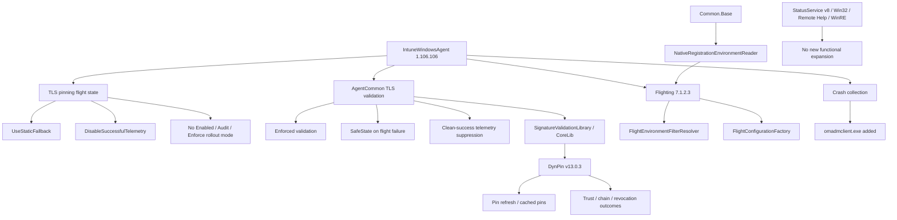

# ime-1.106.102.0-to-1.106.106.0

## Scope

This document describes the changes found between these Intune Management Extension packages:

| Package | Version |
| --- | --- |
| Previous package | `1.106.102.0` |
| New package | `1.106.106.0` |

Evidence sources: MSI database and table comparison, complete extraction of both embedded CAB payloads, SHA-256 comparison of every payload file, ECMA-335 metadata table comparison for managed assemblies, managed type, method, field and user-string inspection, selected method-body comparison, PE section comparison for native binaries, native string inspection, direct comparison of the nested WinRE CAB and manifest, and extraction and comparison of the actual `IntuneWindowsAgentCustomActions` SfxCA binary stream from both packages.

The embedded MSI cabinets use the same irregular layout seen in preceding IME packages. Several MSI file records refer to duplicate compressed extents, so the extracted payload contains 151 unique payload extents for 154 MSI `File` rows. The duplicate aliases were accounted for when calculating byte-level change counts.

This report separates three different kinds of change:

1. **Behavioral change**, where types, methods, fields, strings, method bodies, or native executable code show new runtime behavior.
2. **Shared-library refresh**, where Microsoft moves a related group of policy, trust, telemetry, or component binaries forward together.
3. **Rebuild noise**, where hashes or version resources change without evidence of a new code path.

This is an independent investigation report. Presence of code does not mean every optional path or telemetry switch is active for every tenant.

## Independent verification

The most load-bearing claims in this report were independently re-derived from the supplied packages:

* `TlsCertificatePinningMode` exists in `1.106.102.0` and is absent in `1.106.106.0`.
* The `Enabled`, `Enforce`, and `Mode` members disappear from `TlsCertificatePinningFlightState`.
* `DisableSuccessfulTlsCertificatePinningTelemetry` and `DisableSuccessfulTelemetry` are new in `1.106.106.0`.
* Failure strings change from disabled/platform-only fallback wording to **safe defaults** and **enforcing with safe defaults**.
* The shared Microsoft client stack moves from `7.1.1.65` to `7.1.2.3`.
* Root `dynpin_cxx.dll` changes native `.text` code and its visible pin service API moves from `api/pinning/v12.2.9` to `api/pinning/v13.0.3`.
* `Microsoft.Management.Clients.Flighting.dll` adds environment-resolution types and explicit environment mappings.
* `omadmclient.exe` is newly added to IME crash collection application names.
* The WinRE CAB and WinRE manifest are byte-identical between the two packages.
* The SfxCA custom-action package retains the same eight embedded files and `SideCarSetupCustomActions.dll` has no method-body or user-string change.

## Executive summary

`1.106.106.0` is a focused servicing release. Unlike `1.106.102.0`, which introduced StatusService v8, app deadline status, Golden Signals, Trouter connectivity work, and a large WinRE refresh, this build concentrates on **TLS certificate pinning hardening and the shared trust/policy stack behind it**.

The important changes are:

1. **The old TLS certificate-pinning rollout model disappears.** `TlsCertificatePinningMode` and its `Disabled`, `Audit`, and `Enforce` values are removed from AgentCommon.
2. **The feature and enforcement gates are removed from the flight state.** `TlsCertificatePinningFlightState` loses `Enabled`, `Enforce`, and `Mode`; it keeps `UseStaticFallback` and gains `DisableSuccessfulTelemetry`.
3. **Flight-resolution failure now fails safe instead of disabling pinning.** Strings that previously said `defaulting to disabled`, `using Disabled`, or `using PlatformOnly` are replaced with `enforcing with safe defaults` / `using safe defaults` behavior.
4. **Successful TLS-pinning telemetry gets its own optional control.** A new `DisableSuccessfulTlsCertificatePinningTelemetry` flight and `IsCleanSuccess` path allow clean-success telemetry to be suppressed without switching off certificate enforcement.
5. **The shared policy/trust/component cohort moves from `7.1.1.65` to `7.1.2.3`.** This includes Common.Base, Common.Telemetry, Flighting, Common.SignatureValidation, Policy.Runtime/Base, Components.Runtime/Base, IntuneComponent, CoreLib, SignatureValidationLibrary, IntunePolicyStorage, IntunePolicyAdapter, and related binaries.
6. **DynPin receives a real native-code update.** Root `dynpin_cxx.dll` grows from 971,072 to 971,616 bytes, its `.text` section changes, and the visible service path moves from `api/pinning/v12.2.9` to `api/pinning/v13.0.3`.
7. **The refreshed DynPin build adds/changes trust and refresh diagnostics.** New visible failure concepts include certificate trust validation failure, more explicit pin-refresh behavior, and named validation outcomes such as expired pins, chain mismatch, revocation-check failure, and unavailable pin documents.
8. **ECS environment selection is expanded.** `Microsoft.Management.Clients.Flighting.dll` adds `FlightEnvironmentFilterResolver` and `FlightConfigurationFactory`, with mappings for environments including OneDF, SelfHost, CTIP, PPE, MIG, PE, FXB, FXP, CNB, CNP, and BLP.
9. **Common.Base gains a registration-environment reader abstraction.** New types include `IRegistrationEnvironmentReader` and `NativeRegistrationEnvironmentReader`.
10. **IME crash telemetry now includes `omadmclient.exe`.** This is the same narrow OMA-DM diagnostic addition seen in the `1.105.152.0 -> 1.105.154.0` servicing branch.
11. **The large `1.106.102.0` feature work remains stable.** StatusService v8, Win32 status negotiation/deadline handling, ScriptPlugIn, DataSensor, Remote Help executor, and BootstrapperAgentCore do not gain a new feature path here.
12. **WinRE does not change at all.** The nested WinRE CAB and its companion manifest are byte-identical.
13. **MSI setup mechanics remain unchanged.** No files, components, services, registry rows, custom actions, or installer sequence entries are added or removed.
14. **The custom-action code is semantically unchanged.** Only the version/build binary changes; the managed metadata shape, method bodies, and user strings are unchanged.

The best headline for this build is therefore:

> **IME 1.106.106.0 takes Sidecar TLS certificate pinning out of rollout mode, changes failure behavior to enforced safe defaults, and refreshes the shared Microsoft trust/policy stack and DynPin engine that perform the validation.**

## Package-level changes

| Property | 1.106.102.0 | 1.106.106.0 |
| --- | --- | --- |
| ProductVersion | `1.106.102.0` | `1.106.106.0` |
| ProductCode | `{AF98F07E-B150-462A-BC23-DE6C1B377D58}` | `{A99DF952-D7EE-44E9-B277-A9881EAC57B0}` |
| UpgradeCode | `{9FE9701C-0F89-40B4-B77A-AA65607E87D8}` | same |
| Package/Revision GUID | `{8BC80A88-96E2-4711-B92A-D909548A822D}` | `{56F4DF95-ED3F-469F-ACE1-4A7B0A867C80}` |
| MSI Summary create time | `2026-09-09 17:44:06` | `2026-09-26 00:50:18` |
| MSI SHA-256 | `5664b8225d3d58042bb530ddae72e92fb39758837b1cae1cdde895714fa31134` | `86efca064c8f0e0a49311ed7d258f60dae2da0f7078e8151c4c473681d7fb448` |
| MSI file size | 13,840,384 bytes | 13,840,384 bytes |
| Embedded CAB size | 13,246,472 bytes | 13,250,216 bytes (`+3,744`) |
| MSI `File` rows | 154 | 154 |
| Unique extracted payload extents | 151 | 151 |
| Files added | 0 | 0 |
| Files removed | 0 | 0 |
| Unique extents changed | — | 91 |
| Unique extents byte-identical | — | 60 |

The MSI still uses WiX Toolset `5.0.2.0`.

The equal MSI size is notable. The release is not a package expansion: it replaces and rebuilds existing binaries while leaving the installer inventory intact.

## No payload inventory change

There are no new MSI payload files and no removed payload files.

The important distinction is that many existing files are rebuilt to the new IME version and the shared `7.1.2.3` client stack, but the actual feature/component inventory remains the same.

## Largest payload size deltas

| File | 1.106.102.0 | 1.106.106.0 | Size delta | Version change |
| --- | ---: | ---: | ---: | --- |
| `IntunePolicyAdapter.dll` | 779,088 | 794,424 | `+15,336` | `7.1.1.65 -> 7.1.2.3` |
| `IntunePolicyStorage.dll` | 1,097,040 | 1,109,304 | `+12,264` | `7.1.1.65 -> 7.1.2.3` |
| `Microsoft.Management.Clients.Flighting.dll` | 53,584 | 56,120 | `+2,536` | `7.1.1.65 -> 7.1.2.3` |
| `CoreLib.dll` | 1,084,240 | 1,082,168 | `-2,072` | `7.1.1.65 -> 7.1.2.3` |
| `SignatureValidationLibrary.dll` | 519,504 | 517,472 | `-2,032` | `7.1.1.65 -> 7.1.2.3` |
| `Microsoft.Management.Clients.Components.Runtime.dll` | 297,848 | 296,800 | `-1,048` | `7.1.1.65 -> 7.1.2.3` |
| `Microsoft.Management.Clients.Common.Base.dll` | 114,512 | 115,512 | `+1,000` | `7.1.1.65 -> 7.1.2.3` |
| `Microsoft.Management.Clients.Policy.Runtime.dll` | 111,992 | 111,416 | `-576` | `7.1.1.65 -> 7.1.2.3` |
| `Microsoft.Management.Clients.Common.Telemetry.dll` | 83,360 | 82,784 | `-576` | `7.1.1.65 -> 7.1.2.3` |
| `dynpin_cxx.dll` | 971,072 | 971,616 | `+544` | native |
| `Microsoft.Management.Clients.Components.Base.dll` | 37,200 | 37,728 | `+528` | `7.1.1.65 -> 7.1.2.3` |
| `Microsoft.Management.Services.IntuneWindowsAgent.exe` | 538,016 | 538,488 | `+472` | `1.106.102.0 -> 1.106.106.0` |

`IntunePolicyStorage.dll` and `dynpin_cxx.dll` each have two MSI file records in different install locations. The underlying version/update is the same family in both copies.

The largest changes therefore cluster around the shared policy/trust stack rather than Win32 app processing, StatusService, Remote Help, or WinRE.

## Largest managed-code deltas

| Assembly | TypeDef | MethodDef | Field | Size delta |
| --- | ---: | ---: | ---: | ---: |
| `Microsoft.Management.Clients.Flighting.dll` | `46 -> 51` | `204 -> 209` | `154 -> 160` | `+2,536` |
| `Microsoft.Management.Clients.Common.Base.dll` | `123 -> 127` | `491 -> 497` | `462 -> 466` | `+1,000` |
| `Microsoft.Management.Services.IntuneWindowsAgent.exe` | `304 -> 305` | `1371 -> 1373` | `1509 -> 1516` | `+472` |
| `Microsoft.Management.Services.IntuneWindowsAgent.AgentCommon.dll` | `674 -> 673` | `3326 -> 3325` | `3269 -> 3265` | `+40` |
| `Microsoft.Management.Clients.Common.SignatureValidation.dll` | `30 -> 32` | `153 -> 155` | `153 -> 154` | `+16` |
| `Microsoft.Management.Clients.Policy.Runtime.dll` | `90 -> 92` | `346 -> 348` | `323 -> 324` | `-576` |
| `Microsoft.Management.Clients.Components.Runtime.dll` | `195 -> 197` | `811 -> 813` | `1149 -> 1150` | `-1,048` |
| `Microsoft.Management.Clients.Components.Base.dll` | `26 -> 28` | `175 -> 177` | `93 -> 94` | `+528` |
| `Microsoft.Management.IntuneComponent.exe` | `26 -> 28` | `110 -> 112` | `98 -> 99` | `-24` |

Several `7.1.2.3` managed libraries gain compiler-support types such as `Microsoft.CodeAnalysis.EmbeddedAttribute` and `System.Runtime.CompilerServices.RefSafetyRulesAttribute`. Those additions alone are build/compiler evidence rather than a feature. The meaningful new managed behavior is concentrated in Flighting, Common.Base, the main IME service, and AgentCommon.

# 1. TLS certificate pinning loses its Disabled/Audit/Enforce rollout enum

The clearest behavioral change is in:

```text
Microsoft.Management.Services.IntuneWindowsAgent.AgentCommon.dll
```

In `1.106.102.0`, AgentCommon defines:

```text
TlsCertificatePinningMode

Disabled
Audit
Enforce
```

The type disappears entirely in `1.106.106.0`.

That is more significant than a renamed flight. It removes the explicit three-state runtime model that allowed the pinning code to distinguish between a disabled path, an audit/comparison path, and a fully enforced path.

> **In plain terms:** in `102`, certificate pinning still looked like something Microsoft could progressively roll out: turn it off, run it in audit mode, then enforce it. In `106`, that rollout-state enum is gone. The code no longer models “Disabled/Audit/Enforce” as three operating modes.

# 2. `TlsCertificatePinningFlightState` is simplified to optional behavior only

The flight-state object changes directly.

`1.106.102.0`:

```text
TlsCertificatePinningFlightState

Enabled
Enforce
UseStaticFallback
Mode
```

The underlying fields are:

```text
<Enabled>k__BackingField
<Enforce>k__BackingField
<UseStaticFallback>k__BackingField
```

`1.106.106.0`:

```text
TlsCertificatePinningFlightState

UseStaticFallback
DisableSuccessfulTelemetry
```

The fields become:

```text
<UseStaticFallback>k__BackingField
<DisableSuccessfulTelemetry>k__BackingField
```

The provider changes as well:

```text
1.106.102.0
DisabledState

1.106.106.0
SafeState
```

This is strong evidence that the remaining flight state controls optional behavior around the enforced validation path rather than whether validation exists at all.

# 3. The feature/enforcement flight names disappear from the main agent

The main IME executable removes these visible flight names:

```text
EnableTlsCertificatePinning
EnforceTlsCertificatePinning
```

It adds:

```text
DisableSuccessfulTlsCertificatePinningTelemetry
```

The main agent also removes:

```text
LogFlightMisconfiguration
```

and adds:

```text
ResolveDisableSuccessfulTlsTelemetryFlightAsync
```

with its compiler-generated async state type.

This matches the AgentCommon structural change: the code no longer needs a feature flight plus a separate enforcement flight, but it still resolves an optional telemetry-only flight.

> **In plain terms:** Microsoft appears to have moved the security behavior out of the “should we enable/enforce this?” flighting system. What remains flight-controlled is whether IME sends clean-success telemetry and whether it uses the existing static fallback behavior.

# 4. Flight-resolution failure changes from disabled to safe enforcement

The old failure strings are unusually direct.

`1.106.102.0` includes:

```text
[TlsCertificatePinning] Failed to resolve Boolean flights; defaulting to disabled. Exception=
```

and AgentCommon includes:

```text
[TlsCertificatePinning] Background flight refresh failed; using Disabled. Exception=
```

```text
[TlsCertificatePinning] Rollout-mode evaluation failed; using PlatformOnly. Exception={0}
```

In `1.106.106.0`, those become:

```text
[TlsCertificatePinning] Failed to resolve optional Boolean flights; enforcing with safe defaults. Exception=
```

```text
[TlsCertificatePinning] Background flight refresh failed; using safe defaults. Exception=
```

```text
[TlsCertificatePinning] Flight-state evaluation failed; enforcing with safe defaults. Exception={0}
```

This is the strongest evidence in the entire comparison.

It shows a deliberate change in the security failure posture:

```text
1.106.102.0
flight-resolution problem
        ↓
disabled / PlatformOnly fallback

1.106.106.0
flight-resolution problem
        ↓
enforce with safe defaults
```

> **In plain terms:** if IME could not determine the certificate-pinning rollout configuration in `102`, it had explicit code paths that could fall back to disabled or platform-only behavior. In `106`, the equivalent failure is described as enforcing with safe defaults. That is a fail-safer posture and is likely the central reason for this servicing release.

# 5. The validation path itself is rewritten as an enforced path

AgentCommon changes the validation failure message from:

```text
[TlsCertificatePinning] SVL validation failed in mode {0}: {1}
```

to:

```text
[TlsCertificatePinning] Enforced SVL validation failed: {0}
```

The resolved-chain warning also changes from:

```text
[TlsCertificatePinning] Platform TLS did not provide a resolved certificate chain in mode {0}.
```

to:

```text
[TlsCertificatePinning] Platform TLS did not provide a resolved certificate chain.
```

The old telemetry property:

```text
ResultsMatch
```

disappears, while an explicit visible value:

```text
Enforce
```

remains.

This fits a design where the client no longer needs to compare an audit result with the platform result as part of a rollout-mode experiment.

# 6. Clean successful TLS-pinning telemetry can now be suppressed

`1.106.106.0` adds:

```text
DisableSuccessfulTlsCertificatePinningTelemetry
```

AgentCommon exposes:

```text
DisableSuccessfulTelemetryFlight
```

and `TlsCertificatePinningContext` adds:

```text
IsCleanSuccess
```

There is also an explicit failure message:

```text
[TlsCertificatePinning] Failed to resolve telemetry-only flight 'DisableSuccessfulTlsCertificatePinningTelemetry'; suppressing clean successful Sidecar telemetry. Exception=
```

The wording matters: Microsoft describes this as a **telemetry-only** flight.

This cleanly separates enforcement from observability:

```text
Certificate validation      enforced path
Static fallback             optional behavior
Successful telemetry        optional behavior
```

A failure to resolve the telemetry flight results in suppressing clean-success telemetry, not in weakening certificate validation.

# 7. AgentCommon's TLS state model becomes smaller, not larger

AgentCommon actually decreases from 674 to 673 TypeDefs and from 3,326 to 3,325 MethodDefs.

The relevant type/method delta is:

Removed type:

```text
TlsCertificatePinningMode
```

Removed methods:

```text
TlsCertificatePinningFlightState.get_Enabled
TlsCertificatePinningFlightState.get_Enforce
TlsCertificatePinningFlightState.get_Mode
TlsCertificatePinningFlightStateProvider.DisabledState
```

Added methods:

```text
TlsCertificatePinningContext.IsCleanSuccess
TlsCertificatePinningFlightState.get_DisableSuccessfulTelemetry
TlsCertificatePinningFlightStateProvider.SafeState
```

That shape is consistent with simplification after rollout: remove the enable/audit/enforce machinery and retain the operational knobs that are still useful.

# 8. The shared Microsoft policy/trust stack moves to `7.1.2.3`

The previous release retained the root `7.1.1.65` trust/component foundation. `1.106.106.0` moves that cohort forward.

Key examples:

| Component | 1.106.102.0 | 1.106.106.0 |
| --- | --- | --- |
| `Microsoft.Management.Clients.Common.Base.dll` | `7.1.1.65` | `7.1.2.3` |
| `Microsoft.Management.Clients.Common.Telemetry.dll` | `7.1.1.65` | `7.1.2.3` |
| `Microsoft.Management.Clients.Common.EtwProvider.Sidecar.dll` | `7.1.1.65` | `7.1.2.3` |
| `Microsoft.Management.Clients.Flighting.dll` | `7.1.1.65` | `7.1.2.3` |
| `Microsoft.Management.Clients.Common.SignatureValidation.dll` | `7.1.1.65` | `7.1.2.3` |
| `Microsoft.Management.Clients.Policy.Base.dll` | `7.1.1.65` | `7.1.2.3` |
| `Microsoft.Management.Clients.Policy.Runtime.dll` | `7.1.1.65` | `7.1.2.3` |
| `Microsoft.Management.Clients.Components.Base.dll` | `7.1.1.65` | `7.1.2.3` |
| `Microsoft.Management.Clients.Components.Runtime.dll` | `7.1.1.65` | `7.1.2.3` |
| `Microsoft.Management.IntuneComponent.exe` | `7.1.1.65` | `7.1.2.3` |
| `CoreLib.dll` | `7.1.1.65` | `7.1.2.3` |
| `SignatureValidationLibrary.dll` | `7.1.1.65` | `7.1.2.3` |
| `IntunePolicyStorage.dll` | `7.1.1.65` | `7.1.2.3` |
| `IntunePolicyAdapter.dll` | `7.1.1.65` | `7.1.2.3` |
| `PolicyStorageCmdlets.dll` | `7.1.1.65` | `7.1.2.3` |

This is not just a Sidecar version-stamp update. The native trust/policy binaries and managed environment/flight libraries also change their executable logic.

# 9. DynPin moves from pinning API v12.2.9 to v13.0.3

The root `dynpin_cxx.dll` changes from:

```text
1.106.102.0
Size      971,072 bytes
.text     762,368 bytes
.text SHA-256
8c619128ebc7d3cc5e83a74bd90bf99394a3aa801b26e6f57894544766a3fd66
```

to:

```text
1.106.106.0
Size      971,616 bytes
.text     762,880 bytes
.text SHA-256
5a63fa442d777ea1acc9468763308bd5d3017fd00f0f1c78d2fa6d8874bc698c
```

The `.text` difference proves that this is not only resource/version/signing churn.

The visible DynPin service path changes from:

```text
api/pinning/v12.2.9
```

to:

```text
api/pinning/v13.0.3
```

The transitions path remains visible as:

```text
api/transitions/v1
```

> **In plain terms:** the certificate-pinning engine itself moves to a newer implementation generation. The IME wrapper is not merely changing a switch around identical native code.

# 10. DynPin gains more explicit trust and pin-refresh outcomes

The `v13.0.3` native build exposes additional or changed diagnostic concepts including:

```text
Certificate trust validation failed

Unable to refresh pins from network, continuing to use cached pins

Successfully refreshed pins from network

Trying to refresh pins from network
```

and visible validation/result names:

```text
NoTrustRootsForPayloadSubject
CertValidationFailed
CertExpired
PinsExpired
ChainDoesntMatchPins
RevocationCheckFailed
PinDocumentUnavailable
```

It also contains new/changed handling around JWT/pin retrieval and certificate-chain parsing.

The exact runtime branch associated with every native string is not reconstructed here, so this report does not claim a specific bug such as “expired pins caused X” or “revocation caused Y.” What is directly proven is that the DynPin generation and executable code changed, and that the new build contains richer failure/refresh classification.

# 11. Other native trust/policy binaries contain real executable-code changes

Selected native `.text` comparisons:

| Binary | 1.106.102.0 `.text` SHA-256 | 1.106.106.0 `.text` SHA-256 | Result |
| --- | --- | --- | --- |
| `CoreLib.dll` | `6941ad9ac636e97aa8c37c51c4bfa8f9664aa264099bc03c56d623f858eed100` | `697c3b62bc608ea2dbbe9abacbda3852073c326dcb23b3b3cbb021f12e1f6dcc` | changed |
| `SignatureValidationLibrary.dll` | `cb2654273d61322de5d1fc5c28f8be2df1617fe68f1eb7419cd476b9d62d3a72` | `2d75cba6b6def033f01c9d776f3954693791522598942e455ed38384c6ca8ed9` | changed |
| `IntunePolicyStorage.dll` | `b00f6211593974dc244104ff024ed66f5eb60cff445d50b5c30d2a51e572de79` | `6c8f36fda92a8af7b652c1f49ec4ce6d75d7dc4b1e3cb26ac58c2f9e3abf190e` | changed |
| `IntunePolicyAdapter.dll` | `474e2063c2eb6de5a7a525f8dc2aa953dfd7157845a64ff8ec05d6141a8eca03` | `ef31beefc792e6c8440cb02694932309ece197893e53284065d2135ca0b06092` | changed |
| `dynpin_cxx.dll` | `8c619128ebc7d3cc5e83a74bd90bf99394a3aa801b26e6f57894544766a3fd66` | `5a63fa442d777ea1acc9468763308bd5d3017fd00f0f1c78d2fa6d8874bc698c` | changed |

This is useful context because a large rebuild cohort can otherwise look more significant than it is. Here, at least the key native security/policy components have genuinely changed executable sections.

# 12. Flighting gains explicit cloud-environment resolution

`Microsoft.Management.Clients.Flighting.dll` grows from:

```text
Size       53,584 -> 56,120 bytes
TypeDef        46 -> 51
MethodDef     204 -> 209
Field         154 -> 160
Version    7.1.1.65 -> 7.1.2.3
```

New meaningful types include:

```text
FlightEnvironmentFilterResolver
FlightConfigurationFactory
```

New meaningful methods include:

```text
FlightEnvironmentFilterResolver.TryGetFilterValue
FlightConfigurationFactory.Create
```

Visible environment values include:

```text
OneDF
SelfHost
CTIP
PPE
MIG
PE
FXB
FXP
CNB
CNP
BLP
```

New messages include:

```text
Using caller-supplied ECS environment filter override.

The environment filter must contain exactly one nonempty value.

No ECS environment filter mapping is defined for cloud environment '{0}'.
```

This is direct evidence that the shared Flighting library now has a more explicit mapping layer between the registration/cloud environment and the ECS environment filter used for configuration lookup.

> **In plain terms:** instead of every caller having to know how a particular Intune cloud/environment name maps to ECS, the shared Flighting library now contains a resolver/factory for that mapping and validates overrides more explicitly.

# 13. Common.Base gains a native registration-environment reader

`Microsoft.Management.Clients.Common.Base.dll` adds:

```text
IRegistrationEnvironmentReader
NativeRegistrationEnvironmentReader
```

with methods:

```text
GetRegistrationEnvironment
```

and new constructor/state naming around:

```text
environmentReader
```

This lines up with the Flighting changes above. The shared libraries now have a dedicated abstraction for reading the device registration environment and a dedicated resolver for mapping that environment into ECS configuration selection.

# 14. `omadmclient.exe` is added to IME crash collection

The main `Microsoft.Management.Services.IntuneWindowsAgent.exe` adds the user string:

```text
omadmclient.exe
```

The addition is in the common telemetry/crash-collection setup path.

The configured application list therefore expands to include the Windows OMA-DM client alongside IME processes such as:

```text
Microsoft.Management.Services.IntuneWindowsAgent.exe
AgentExecutor.exe
ImeUI.exe
Microsoft.Management.Clients.CopyAgentCatalog.exe
ClientHealthEval.exe
ClientCertCheck.exe
SensorLogonTask.exe
omadmclient.exe
```

This does **not** mean `omadmclient.exe` itself is fixed by this MSI. `omadmclient.exe` is a Windows component and is not delivered by the IME package.

What the IME change does prove is that the existing application-crash collection configuration now includes OMA-DM client crashes/hangs as diagnostic input.

# 15. Main IME TLS flight logic changes alongside the OMADM telemetry addition

`Microsoft.Management.Services.IntuneWindowsAgent.exe` changes from:

```text
TypeDef    304 -> 305
MethodDef 1371 -> 1373
Field     1509 -> 1516
Size      538,016 -> 538,488
```

The meaningful new async method is:

```text
ResolveDisableSuccessfulTlsTelemetryFlightAsync
```

and the old helper:

```text
LogFlightMisconfiguration
```

is removed.

The user-string delta is compact and highly focused:

Added:

```text
DisableSuccessfulTlsCertificatePinningTelemetry
[TlsCertificatePinning] Failed to resolve optional Boolean flights; enforcing with safe defaults. Exception=
[TlsCertificatePinning] Failed to resolve telemetry-only flight 'DisableSuccessfulTlsCertificatePinningTelemetry'; suppressing clean successful Sidecar telemetry. Exception=
omadmclient.exe
```

Removed:

```text
EnableTlsCertificatePinning
EnforceTlsCertificatePinning
TlsCertificatePinning
[TlsCertificatePinning] Failed to resolve Boolean flights; defaulting to disabled. Exception=
] Enforcement flight is enabled while the feature flight is disabled; enforcement will be ignored.
```

This is one of the strongest “small delta, large meaning” areas in the build.

# 16. StatusService v8 is unchanged functionally

`1.106.102.0` introduced the major StatusService v8 changes, including:

```text
AppInstallStatus3
AppInstallStatusCategory
AppInstallSubstatus
DownloadedPendingInstallDeadline
InstallDeadlineTime
NegotiateSessionVersionAsync
```

In `1.106.106.0`, `StatusServiceLibrary.dll` keeps exactly the same managed metadata shape:

```text
TypeDef     21 -> 21
MethodDef   72 -> 72
Field      169 -> 169
MemberRef   24 -> 24
```

Its file size moves only from 28,536 to 28,576 bytes and the assembly version advances with the IME build.

No new status-contract type, method, enum value, deadline field, or negotiation member was found.

So this servicing build should **not** be described as another app-status release.

# 17. Win32 app, Script, DataSensor, Remote Help executor, and bootstrapper behavior is stable

Several feature-heavy assemblies from `1.106.102.0` retain the same managed metadata shape:

```text
Win32AppPlugIn.dll
TypeDef     692 -> 692
MethodDef  3404 -> 3404
Field      2547 -> 2547

ScriptPlugIn.dll
TypeDef      90 -> 90
MethodDef   434 -> 434
Field       355 -> 355

DataSensorPlugIn.dll
TypeDef      87 -> 87
MethodDef   401 -> 401
Field       433 -> 433

AgentExecutor.exe
TypeDef      42 -> 42
MethodDef   168 -> 168
Field       212 -> 212

BootstrapperAgentCore.dll
TypeDef     128 -> 128
MethodDef   620 -> 620
Field       632 -> 632
```

Those binaries may have new version/build hashes, but no new managed feature surface comparable to the TLS/Flighting changes was found.

That means the following `1.106.102.0` stories remain as they were:

```text
StatusService v8 / app category+substatus
install-deadline reporting
ESP deferred retry hook
Managed Installer Golden Signals
Remote Help toast render outcomes
DataSensor IME MSI event query
```

# 18. WinRE is byte-identical

The nested WinRE CAB is exactly the same in both packages.

```text
1.106.102.0
Microsoft.Intune.WinRe.Bundle.cab
Size    3,883,656 bytes
SHA-256 a506a06094656787d8dd11069831b24aa3f167b6616f8ae0f5a6c3c48e0d3472

1.106.106.0
Microsoft.Intune.WinRe.Bundle.cab
Size    3,883,656 bytes
SHA-256 a506a06094656787d8dd11069831b24aa3f167b6616f8ae0f5a6c3c48e0d3472
```

The companion manifest is also byte-identical:

```text
Size    6,806 bytes
SHA-256 a0f7868c7684404631215173f9e33ea5b2ab31d05f7927fbc1d6413f7a97b656
```

So none of the following WinRE work introduced in `1.106.102.0` changes again here:

```text
WinRE downloader framework
check-in URL allowlist/hardening
certificate-chain offline handling
no-op telemetry tracking
WinRE trust-library refresh
```

> **In plain terms:** `106` is a root/normal-Windows IME servicing release. Microsoft did not touch the recovery-environment bundle at all.

# 19. OneDSApi is rebuilt, but its executable `.text` is identical

`OneDSApi.dll` changes file hash and shrinks slightly:

```text
191,392 -> 191,352 bytes
```

However its `.text` section is identical in both packages:

```text
Size        49,152 bytes
SHA-256     2ac0c17e8991cfbfffd55be53f47018d98f78c7ef7bc1dcbbd74c8f686dfc06d
```

This is a useful example of why a raw changed-file count overstates the functional scope of the servicing build. Not every changed binary contains changed executable code.

# 20. The custom-action package has no semantic code change

The `Binary.IntuneWindowsAgentCustomActions` stream changes only slightly:

```text
1.106.102.0: 479,808 bytes
1.106.106.0: 479,792 bytes
```

The embedded SfxCA CAB still contains the same eight files:

```text
SideCarSetupCustomActions.dll
System.Diagnostics.EventLog.dll
System.Security.Principal.Windows.dll
System.ServiceProcess.ServiceController.dll
Microsoft.Win32.TaskScheduler.dll
WixToolset.Dtf.WindowsInstaller.dll
Microsoft.Win32.TaskScheduler.resources.dll
CustomAction.config
```

Seven files are byte-identical.

`SideCarSetupCustomActions.dll` changes binary hash but remains exactly the same size:

```text
56,224 bytes -> 56,224 bytes
```

Its managed metadata shape is identical:

```text
TypeDef     29 -> 29
MethodDef   81 -> 81
Field      145 -> 145
MemberRef  172 -> 172
ImplMap     14 -> 14
```

Direct method-body comparison found:

```text
0 changed method bodies
0 added/removed methods
0 added/removed user strings
```

So there is no evidence of a new MSI custom-action code path in this hotfix.

# 21. MSI mechanics remain structurally unchanged

At the MSI database level, the important table counts are identical:

| Table | 1.106.102.0 | 1.106.106.0 | Functional change |
| --- | ---: | ---: | --- |
| `File` | 154 | 154 | No file added/removed; existing rows receive build/version/size updates |
| `Component` | 161 | 161 | None |
| `FeatureComponents` | 161 | 161 | None |
| `Registry` | 9 | 9 | None |
| `CustomAction` | 22 | 22 | None |
| `InstallExecuteSequence` | 52 | 52 | None |
| `InstallUISequence` | 9 | 9 | None |
| `AdminExecuteSequence` | 8 | 8 | None |
| `ServiceInstall` | 1 | 1 | None |
| `ServiceControl` | 1 | 1 | None |
| `RemoveFile` | 7 | 7 | None |
| `Feature` | 1 | 1 | None |
| `Directory` | 57 | 57 | None |
| `MsiFileHash` | 23 | 23 | Same rows; hashes updated where required |

The `Property` table changes only the normal:

```text
ProductCode
ProductVersion
```

The `Upgrade` table moves its version boundary from:

```text
1.106.102.0
```

to:

```text
1.106.106.0
```

The `Signature` table similarly changes `NewerFileVersionSearch.MinVersion` from `1.106.102.0` to `1.106.106.0`.

No MSI action is added specifically for certificate pinning, DynPin, ECS environment resolution, or OMADM crash collection. Those are runtime changes inside existing installed components.

# 22. Architecture overview



The diagram represents the visible client architecture and relationships. It does not claim a server-side activation sequence that cannot be observed from the MSI.

## Why `1.106.106.0` looks like a hotfix rather than a feature release

Several characteristics point in the same direction:

* The MSI is exactly the same size as `1.106.102.0`.
* No payload file is added or removed.
* No MSI component, service, registry, feature, directory, or custom action is added.
* The previous release's large app-status/observability/WinRE features do not expand again.
* The meaningful IME-side string/type delta is tightly focused on TLS certificate pinning and crash telemetry.
* A coordinated `7.1.2.3` shared security/policy stack is dropped in at the same time.
* DynPin itself moves to a new service/API generation and changed native code.

The exact internal incident, bug ID, or customer impact that triggered the servicing build is not encoded in the MSI.

## Evidence and confidence

### High confidence: directly visible in MSI tables, managed metadata, strings, hashes, or PE sections

* Product/package identity changes and unchanged MSI structural table counts.
* 154 MSI file rows in both packages, with no additions or removals.
* 151 unique extracted payload extents, with 91 changed and 60 byte-identical.
* Removal of `TlsCertificatePinningMode` and `Disabled/Audit/Enforce`.
* Removal of `Enabled`, `Enforce`, and `Mode` from `TlsCertificatePinningFlightState`.
* Addition of `DisableSuccessfulTelemetry` and `IsCleanSuccess`.
* Replacement of `DisabledState` with `SafeState`.
* Removal of `EnableTlsCertificatePinning` and `EnforceTlsCertificatePinning` flight strings.
* Addition of `DisableSuccessfulTlsCertificatePinningTelemetry`.
* Failure wording changing from disabled/platform-only fallback to safe-default enforcement.
* `7.1.1.65 -> 7.1.2.3` version move across the shared trust/policy/component cohort.
* Root DynPin `.text` changes and `api/pinning/v12.2.9 -> api/pinning/v13.0.3`.
* Changed native executable sections in CoreLib, SignatureValidationLibrary, IntunePolicyStorage, and IntunePolicyAdapter.
* New Flighting environment resolver/factory types and visible environment mappings.
* New Common.Base registration-environment reader types.
* Addition of `omadmclient.exe` to main-agent telemetry configuration strings.
* StatusService v8 metadata shape unchanged.
* Win32AppPlugIn, ScriptPlugIn, DataSensorPlugIn, AgentExecutor, and BootstrapperAgentCore metadata shapes unchanged.
* WinRE CAB and manifest byte-identical.
* Custom-action package inventory unchanged and SideCarSetupCustomActions method bodies/user strings unchanged.

### Strong inference, but not a reconstructed complete IL/native call graph

* TLS certificate pinning has moved from staged rollout semantics to the normal enforced path.
* Safe defaults are intended to preserve certificate validation when ECS/flight state cannot be resolved.
* `DisableSuccessfulTlsCertificatePinningTelemetry` exists to reduce clean-success telemetry volume without weakening enforcement.
* The `7.1.2.3` trust/policy refresh and DynPin v13.0.3 are part of the same certificate-pinning hardening effort.
* FlightEnvironmentFilterResolver and NativeRegistrationEnvironmentReader are intended to make ECS environment selection more deterministic across cloud environments.

### Not proven by the supplied binaries

* The exact Microsoft incident, support case, security review, or regression that caused `1.106.106.0` to be issued.
* A specific CVE associated with this servicing build.
* Whether a particular tenant previously ran TLS pinning in Disabled, Audit, or Enforce mode.
* The exact service-side values Microsoft supplies for the remaining optional TLS-related flights.
* Whether every newly visible DynPin failure category is exercised by the Sidecar TLS scenario.
* Whether the OMADM crash collection addition was triggered by one specific Windows OMA-DM issue.

## Suggested validation

### 1. Validate the enforced-safe-default path

On a device running `1.106.106.0`, capture IME logs around the Sidecar/Gateway TLS path and look for:

```text
TlsCertificatePinning
safe defaults
enforcing
DisableSuccessfulTlsCertificatePinningTelemetry
```

Compare with a `1.106.102.0` device if available.

Expected evidence is that `106` no longer reports Disabled/PlatformOnly as the fallback when optional flight resolution fails.

### 2. Validate the absence of old rollout flights

Capture the ECS/flight resolution used by IME and search for:

```text
EnableTlsCertificatePinning
EnforceTlsCertificatePinning
```

Then compare with:

```text
DisableSuccessfulTlsCertificatePinningTelemetry
UseStaticTlsPinFallback
```

The client binary evidence predicts that the first two no longer participate in the `106` runtime model.

### 3. Validate clean-success telemetry suppression

In a lab where the telemetry-only flight can be observed, compare a successful Sidecar TLS validation with the flight enabled and disabled.

Look for evidence that:

```text
validation still succeeds/enforces
```

while only clean-success telemetry emission changes.

A failed validation should still be observable even if clean-success telemetry is suppressed.

### 4. Validate DynPin refresh behavior

Monitor the TLS/pinning logs while testing controlled conditions such as:

```text
valid cached pins
pin refresh with network available
pin refresh with temporary network loss
expired/stale pin material in an isolated lab
```

Look for the new/changed v13 diagnostics around:

```text
Trying to refresh pins from network
Successfully refreshed pins from network
Unable to refresh pins from network, continuing to use cached pins
Certificate trust validation failed
```

Do not infer a production failure mode solely from one diagnostic string; correlate the final validation result.

### 5. Validate ECS environment resolution

On environments where the registration environment is visible, inspect flighting logs/config resolution for the new environment mapping path.

Useful strings include:

```text
Using caller-supplied ECS environment filter override.
No ECS environment filter mapping is defined for cloud environment
The environment filter must contain exactly one nonempty value.
```

### 6. Validate OMADM crash collection

Generate or locate a controlled `omadmclient.exe` Application Error/Application Hang event in a lab and correlate it with IME crash collection behavior.

The code change proves inclusion in the configured application-name list; on-device validation can confirm which event types and upload path are used in the current service configuration.

### 7. Confirm the unchanged feature areas

For regression comparison, verify that the following remain operationally identical between `102` and `106`:

```text
StatusService negotiated version 8
DownloadedPendingInstallDeadline
InstallDeadlineTime
Remote Help toast outcome reporting
Managed Installer Golden Signals
Trouter reconnect behavior
WinRE component bundle
```

The binary comparison predicts no new client behavior in these areas from this hotfix.

## Final assessment

`1.106.106.0` is best described as a **TLS certificate-pinning hardening and shared trust-stack servicing release**.

The strongest client-side change is not the addition of a new feature. It is the removal of a rollout model. In `1.106.102.0`, TLS certificate pinning still explicitly supported Disabled, Audit, and Enforce states, and failed flight resolution could fall back to disabled or PlatformOnly behavior. In `1.106.106.0`, that mode enum and the enable/enforce state are gone, failure handling says it is **enforcing with safe defaults**, and the only newly introduced flight controls clean-success telemetry rather than security enforcement.

At the same time, Microsoft moves the shared policy/trust stack from `7.1.1.65` to `7.1.2.3`. The root DynPin engine contains changed native code and moves from `api/pinning/v12.2.9` to `api/pinning/v13.0.3`, while CoreLib, SignatureValidationLibrary, IntunePolicyStorage, and IntunePolicyAdapter also receive real executable-code updates. That makes the security-stack refresh materially different from ordinary version-stamp rebuild noise.

A secondary shared-library change improves ECS cloud/environment resolution through `FlightEnvironmentFilterResolver`, `FlightConfigurationFactory`, and a native registration-environment reader. The build also incorporates `omadmclient.exe` into IME's existing application-crash collection list.

Meanwhile, the large `1.106.102.0` feature set remains stable. StatusService stays at v8 with the same contract shape, the main Win32/Script/DataSensor/Remote Help feature assemblies do not expand, and the WinRE CAB and manifest are exactly byte-identical.

The most defensible headline is therefore:

> **IME 1.106.106.0 makes TLS certificate pinning an enforced safe-default path instead of a Disabled/Audit/Enforce rollout, while updating the underlying Microsoft trust/policy stack and DynPin engine that perform the validation.**

The supplied binaries do not identify the exact internal bug, incident, or CVE that prompted the hotfix, so the report should not attribute the release to a specific vulnerability without separate Microsoft evidence.

## Sources

* Supplied `IntuneWindowsAgent_1.106.102.0_manual_ffad3f11(1).msi` package.
* Supplied `IntuneWindowsAgent_1.106.106.0_manual_ffad3f11(1).msi` package.
* Previous IME tracker comparison used for continuity of the `1.106.102.0` baseline: `ime-1.105.152.0-to-1.106.102.0`.
* Internal names, flight names, DynPin paths, TLS failure strings, environment mappings, and native implementation details in this report are derived from the supplied binaries. They are not represented here as Microsoft-published release-note terminology.
