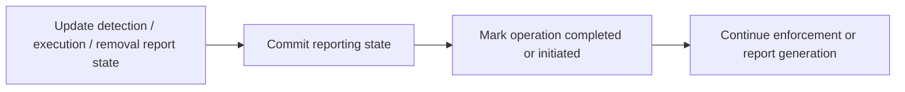
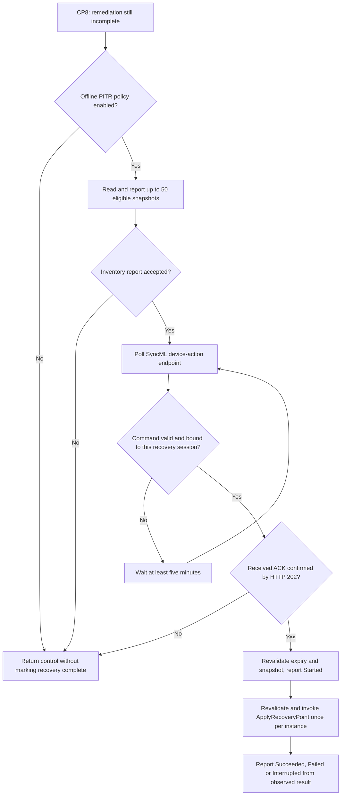

# ime-1.106.106.0-to-1.108.101.0

## Scope

Evidence filenames and line references identify analysis artifacts retained locally. Only this report is published in this repository; the MSI packages, extracted binaries, decompiled files and analysis datasets are not included.

This report compares fresh downloads of the two Intune Management Extension endpoints on **23 October 2026**:

| Package | Download endpoint | ProductVersion |
| --- | --- | --- |
| Previous package / primary | [imeswdb-afd-primary](https://imeswdb-afd-primary.manage.microsoft.com/IntuneWindowsAgent.msi) | `1.106.106.0` |
| New package / secondary | [imeswdb-afd-secondary](https://imeswdb-afd-secondary.manage.microsoft.com/IntuneWindowsAgent.msi) | `1.108.101.0` |

Both downloads returned HTTP 200. The exact UTC acquisition times and URLs are preserved in `downloads.json`. These endpoints are mutable; this report describes the downloaded hashes below, not every future response from those URLs. Secondary served the numerically newer build during this acquisition. That observation does not establish a general promotion order for the endpoint names.

This comparison continues the existing [IME Change Tracker release notes](https://github.com/call4cloud-code/IME-Change-Tracker/tree/main/release-notes), specifically [1.106.102.0 to 1.106.106.0](https://github.com/call4cloud-code/IME-Change-Tracker/blob/main/release-notes/ime-1.106.102.0-to-1.106.106.0.md). The primary MSI is byte-identical to the `1.106.106.0` MSI recorded there. No intermediate `1.107` package was supplied or reconstructed: changes here are the cumulative difference between these two endpoints.

Evidence includes read-only MSI table exports, full embedded-CAB extraction, every MSI File-row SHA-256, CAB-extent/alias validation, MSI-authored file-hash validation, managed metadata and normalized IL comparison, selected C# decompilation, native PE section/import/export comparison, the nested WinRE bundle, and the embedded custom-action package. The attempted IDA run could not complete, so no native function-level decompilation claim is made. No package installation, repair, service start, or target-code execution was performed.

The report distinguishes directly observed code changes, likely consequences of those changes, and behavior that still depends on service configuration, flight values, or runtime testing.

## Executive summary

`1.108.101.0` is a broader feature and reliability update than the preceding `1.106.106.0` servicing release. The outer MSI still installs the same files and uses the same service and custom-action definitions, while existing components gain substantial logic.

The clearest changes are:

1. **Real-time compliance gains optional two-tier polling.** Enabled settings can be divided into fast and slow groups, with effective defaults of five minutes and one hour. The new `EnableTwoTierCompliancePolling` flight defaults to false; this is not proof that every device starts using those intervals.
2. **Compliance monitoring becomes more precise about failure and scheduling.** Failed observations are recorded separately from unchanged settings, hourly rollups gain per-setting failure counts and drift timestamps, timer/start/stop handling is reworked, and Windows Security Center notifications are filtered by actual firewall/antivirus health changes.
3. **The main IME service gains a CPU and memory telemetry job.** It observes the IME process group on a one-hour job period, behind `EnableCpuUsageTelemetry`, and handles baseline samples, collection failures, and bounded shutdown.
4. **Win32 app reporting is committed at enforcement boundaries.** Detection and execution paths persist report changes before marking the corresponding operational state completed or initiated. This narrows a persistence window around interruption or reboot; it does not establish that every reporting problem is fixed.
5. **Compliance-script scheduling gains a separate minute-schedule control.** The detailed branch conditions are examined below; an hourly compliance override also remains flight controlled.
6. **Certificate-pinning diagnostics become a complete collection/upload path.** The new health-report path persists a latest Windows-pinning failure snapshot, omits that report's body from verbose outbound logs, detects unsuccessful sends, and only deletes a snapshot if it is still the one that was uploaded.
7. **Unattended Windows Remote Help stops iterating user sessions for its setup request.** It requests and reports using `Guid.Empty` and session `0`, while retaining prerequisite checks and explicit error reporting.
8. **IC3 token acquisition gains bounded retries for selected outcomes, and Trouter moves to 1.2.26.0.** Null results, successful results with empty tokens, and exceptions can be retried; explicit unsuccessful results are not. Trouter adds short-session reconnect backoff and more coordinated shutdown/lifecycle handling.
9. **Component CAB signature checks become stricter.** The shared verifier now requires successful Authenticode and Microsoft-root results plus consistent signer identity matching Microsoft Corporation. Revocation-unavailable exceptions formerly accepted in this path are removed. Download/signature telemetry gains component-version correlation.
10. **WinRE gains a substantial PITR orchestration path and transactional bundle updates.** It can inventory restore points, poll for a bound command, require an accepted ACK, revalidate and invoke recovery. Bundle installation changes from individual overwrites to staged directory replacement with rollback/recovery. These are code capabilities, not proof of tenant activation or a completed restore.
11. **The native policy/trust stack has changed executable bytes and interfaces.** DynPin adds crypto/flight-provider exports; nested WinRE trust libraries also change. Native function control flow was not reconstructed because native IDA analysis did not complete.
12. **Rebuilds are separated from behavior.** AgentExecutor, ClientCertCheck, ImeUI and several plugins/libraries change binary identity without a demonstrated new managed method path. The outer file inventory remains 154 MSI File rows, with no additions or removals.

## Package identity and extraction

| Property | Primary: 1.106.106.0 | Secondary: 1.108.101.0 |
| --- | --- | --- |
| ProductCode | `{A99DF952-D7EE-44E9-B277-A9881EAC57B0}` | `{6D5A67D6-ECDC-4073-86DB-5EF1C67B4213}` |
| UpgradeCode | `{9FE9701C-0F89-40B4-B77A-AA65607E87D8}` | Same |
| Package/Revision GUID | `{56F4DF95-ED3F-469F-ACE1-4A7B0A867C80}` | `{B84F5099-C4F0-4A61-A2A5-E621B082C997}` |
| MSI bytes | 13,840,384 | 13,987,840 (`+147,456`) |
| MSI SHA-256 | `86efca064c8f0e0a49311ed7d258f60dae2da0f7078e8151c4c473681d7fb448` | `d8f7b8f7d7aae0522e8ff92a4a3aa40738c585900cf00f7b01a7501740c8163d` |
| Authenticode | Valid, Microsoft Corporation | Valid, Microsoft Corporation |
| MSI toolset | WiX `5.0.2.0` | Same |
| MSI File rows recovered | 154 / 154 | 154 / 154 |
| Embedded CAB bytes | 13,250,216 | 13,397,424 (`+147,208`) |
| CAB entries / unique CAB file extents | 154 / 151 | 154 / 151 |
| Files added / removed at MSI target paths | — | 0 / 0 |
| Target-path payload SHA-256 changes | — | 108 changed, 46 identical |

The CAB contains duplicate file extents, defined by the CFFILE folder offset and size. All 154 authored entries were recovered, every extracted size matches its MSI FileSize, all shared-extent aliases have matching hashes, and all 23 MSI-authored `MsiFileHash` rows validate in each package. The **108 changed / 46 identical** count uses all MSI target paths; it intentionally includes the separate installed copies of shared content. It is not a count of distinct code changes or unique CAB file extents.

Package metadata and signatures: `primary/package.json`, `secondary/package.json`. Extraction checks: `primary/extraction-validation.json`, `secondary/extraction-validation.json`. Full file comparison: `payload-diff.json`.

### Largest payload-size changes

| Installed file | Primary bytes | Secondary bytes | Delta | File version |
| --- | --- | --- | --- | --- |
| `ClientComponents/LocalCabs/Microsoft.Intune.WinRe.Bundle.cab` | 3,883,656 | 3,976,014 | +92,358 | `— → —` |
| `Microsoft.IC3.Trouter.dll` | 439,120 | 502,096 | +62,976 | `1.2.25.0 → 1.2.26.0` |
| `IntunePolicyStorage.dll` | 1,109,304 | 1,158,456 | +49,152 | `7.1.2.3 → 7.1.2.9` |
| `PolicyAdapter/IntunePolicyStorage.dll` | 1,109,304 | 1,158,456 | +49,152 | `7.1.2.3 → 7.1.2.9` |
| `Microsoft.Management.Services.IntuneWindowsAgent.exe` | 538,488 | 575,864 | +37,376 | `1.106.106.0 → 1.108.101.0` |
| `PolicyAdapter/dynpin_cxx.dll` | 971,616 | 1,005,880 | +34,264 | `— → —` |
| `dynpin_cxx.dll` | 971,616 | 1,005,880 | +34,264 | `— → —` |
| `Microsoft.Management.Services.IntuneWindowsAgent.AgentCommon.dll` | 781,728 | 814,496 | +32,768 | `1.106.106.0 → 1.108.101.0` |
| `Microsoft.Management.Clients.IntuneManagementExtension.DataSensorPlugIn.dll` | 169,848 | 186,232 | +16,384 | `1.106.106.0 → 1.108.101.0` |
| `ClientHealthEval.exe` | 180,600 | 192,368 | +11,768 | `1.106.106.0 → 1.108.101.0` |
| `Microsoft.Management.Clients.Components.Runtime.dll` | 296,800 | 302,944 | +6,144 | `7.1.2.3 → 7.1.2.9` |
| `PolicyAdapter/IntunePolicyAdapter.dll` | 794,424 | 800,568 | +6,144 | `7.1.2.3 → 7.1.2.9` |
| `Microsoft.Management.Clients.IntuneManagementExtension.ScriptPlugIn.dll` | 251,768 | 253,344 | +1,576 | `1.106.106.0 → 1.108.101.0` |
| `Microsoft.Management.Services.IntuneWindowsAgent.AgentCommon.ServiceContracts.dll` | 45,944 | 46,496 | +552 | `1.106.106.0 → 1.108.101.0` |
| `Microsoft.Management.Clients.Common.Base.dll` | 115,512 | 116,024 | +512 | `7.1.2.3 → 7.1.2.9` |
| `Microsoft.Management.Clients.IntuneManagementExtension.TamperProtection.dll` | 61,816 | 62,328 | +512 | `1.106.106.0 → 1.108.101.0` |

Separate installed copies are shown separately. Full inventory and hashes are in the appendix and JSON evidence.


## 1. Real-time compliance gains fast and slow polling tiers

**Components:** main IME executable and `AgentCommon.ServiceContracts.dll`.

The old `ComplianceMonitorConfig` contains a single `PollIntervalSeconds`. The new contract adds:

```text
FastPollIntervalSeconds
SlowPollIntervalSeconds
FastPollingSettings
SlowPollingSettings
```

`ComplianceMonitorStore.SaveConfig` / `LoadConfig` persist these under:

```text
HKLM\Software\Microsoft\IntuneManagementExtension\ComplianceMonitor\Config
```

The new `EnableTwoTierCompliancePolling` flight is read through `pollingFlightReader` with `defaultValue: false`. The existing `EnableRealTimeComplianceAccount` flight gates monitor launch; `EnableEventBasedComplianceEventLog` separately controls event listening and is not required for polling. At launch, prechecks, service cancellation, and monitor/config state must also permit the monitor to run.

### Effective intervals and group membership

`GetEffectiveTierPollIntervals` uses 300 seconds for fast and 3,600 seconds for slow when a positive configured value is absent. If fast is greater than slow, the pair falls back to 300 / 3,600. Registry reads preserve zero as unset and clamp nonzero interval values to 60–3,600 seconds.

`GetEffectivePollingTiers` filters configured groups against known, enabled settings. It deduplicates setting names, gives the fast group precedence when a setting appears in both lists, and places enabled settings omitted from both explicit lists into fast. This avoids silently dropping an enabled setting merely because the new lists omit it.

There is also a compatibility path when both tier lists are empty: existing `PollIntervalSeconds` chooses the group. A nonpositive value or 300 places enabled settings in fast; another positive legacy interval places them in slow. The new code therefore does **not** define a universal hard-coded list of settings that always use five minutes versus one hour.

### Scheduling changes

The implementation gains monotonic `Stopwatch` due timestamps, separate last-attempt timestamps, initial jitter, a one-second due-time coalescing window, and an explicitly rearmed one-shot timer. A due cycle evaluates only the relevant tier(s); an explicit non-scheduled `RunOneCycleAsync` can still evaluate the full enabled set.

`RefreshConfigAndReconcilePollingSchedule` incorporates fresh configuration and a fresh flight read. Mode changes reconcile due times. Interval changes are related to the last attempt rather than blindly resetting every setting's cadence. `AdvancePollingTier` moves an expired due timestamp forward until it is in the future.

**Likely consequence:** the client can evaluate different compliance settings at different costs/cadences and reduce timer drift or redundant evaluation. **Not established:** the flight or any particular fast/slow server configuration is enabled for a given tenant.

Evidence: `ComplianceMonitor.{LaunchAsync,StartPollingTimer,RunCycleAsync,GetEffectivePollingTiers,GetEffectiveTierPollIntervals,GetDuePollingSettings,ReconcileTierInterval}`, `ComplianceMonitorStore`, and the `decompiled-diffs/Microsoft.Management.Services.IntuneWindowsAgent.AgentCommon.ServiceContracts.decompiled.diff`.

## 2. Compliance start/stop and event processing receive reliability work

The new monitor adds a separate `lifecycleLock`, an `IsStopping` check and `StopCore`. Launch and start are serialized so a second launch cannot start a monitor whose prior lifetime is still stopping. Launch reports failure if it cannot install the polling timer, rather than unconditionally emitting `Started` after the start attempt.

The stop path cancels the current lifetime and waits for active cycle and event-listener-start work. It tracks whether those waits actually completed, can defer completion/cleanup until pending tasks end, and checks the captured lifetime before rearming. A callback from an older lifetime is not treated as the current monitor. Listener and cycle faults are observed and logged. This is visible lifecycle/error-handling work; it has not been stress-tested on this device.

### Windows Security Center notifications become state aware

Previously, `ComplianceEventPublisher.PublishAsync` filtered the signal's supplied setting names directly. For source `wsc.general-change`, the new code reads current firewall and antivirus health through a new `IWindowsSecurityCenterHealthReader` backed by `WscGetSecurityProviderHealth` from System32 `wscapi.dll`.

It caches the last observed provider health and queues:

| Provider comparison | Setting to evaluate |
| --- | --- |
| Firewall health changed, or current/previous health unavailable | `ActiveFirewallRequired` |
| Antivirus health changed, or current/previous health unavailable | `AntivirusRequired` |

If health is known and unchanged for both providers, no settings remain to enqueue from that notification. Failed health reads are logged and remain conservative: unknown health can still trigger evaluation. The existing setting filter, batching, and cooldown then apply.

**Likely consequence:** broad WSC notifications need not cause both settings to be evaluated when neither provider's health changed. This is a client-side observation filter, not a change to the server's compliance verdict.

Evidence: `ComplianceMonitor.{LaunchAsync,Start,StopCore,ScheduleStopCompletion}`, `ComplianceEventPublisher.{PublishAsync,ReadWindowsSecurityCenterHealth}`, `WindowsSecurityCenterHealthReader.TryReadHealth`; `decompiled-diffs/Microsoft.Management.Services.IntuneWindowsAgent.decompiled.diff`.

## 3. Compliance observation failures stop looking like clean no-drift results

In the primary build, `ComplianceSettingHelper.DetectDriftInSetting` catches observation exceptions and returns `null`; a missing observation also returns `null`. That return value is shared with the normal “observed value matches baseline” outcome.

In the secondary build:

1. Cancellation propagates as cancellation.
2. An observation exception is wrapped as `InvalidOperationException`.
3. A missing value also throws an explicit observation-failure exception.
4. The per-setting cycle task records the failed setting ID separately from an actual drift record.
5. `ApplyObservationFailureOutcome` changes an otherwise `Idle` cycle to `Error` with an observation-failure message.

The cycle still collects other successful observations and processes real drift. The failure outcome does not itself manufacture a changed compliance value.

`CycleTelemetry` and `HourlyRollup` gain `ObservationFailedSettingIds` / `ObservationFailedSettingCounts` and `DriftDetectedTimes`. The aggregator now tracks all known setting IDs and includes processed-setting counts in polling rollups as well as event rollups. Drift times are recorded as UTC Unix timestamps in milliseconds when a drift is detected. If cancellation occurs after some tasks completed, completed observations can still contribute their processed/failure counts before cancellation is rethrown.

**Why this matters:** diagnostic telemetry can distinguish “nothing changed” from “the client could not read the setting.” It does not establish a different cloud compliance decision in every failed-observation case.

Evidence: `ComplianceSettingHelper.DetectDriftInSetting`, `ComplianceMonitor.{ExecuteCycleAsync,ApplyObservationFailureOutcome}`, `ComplianceCycleAggregator`, `ComplianceMonitorAuditing.EmitHourlySummary`.

## 4. IME gains an optional CPU and memory telemetry job

The main executable adds `MonitorCpuUsageJob`, `MonitorCpuUsageSchedulerTask`, `SystemCpuUsageDataSource`, `CpuUsageSnapshot`, and `CpuCollectionStatus`. `SetupCommonTelemetry` constructs the job after the common telemetry sink is ready and runs it through the shared background-task scheduler.

| Detail | Observed implementation |
| --- | --- |
| Job period | `TimeSpan.FromHours(1)` |
| Feature gate | `EnableCpuUsageTelemetry` |
| ECS flight check timeout | 30 seconds |
| Default observed process group | `Microsoft.Management.Services.IntuneWindowsAgent` |
| Memory denominator | `Win32_ComputerSystem.TotalPhysicalMemory` from `root\cimv2` |
| Shutdown wait bound | 30 seconds |
| Telemetry events | `CpuUsageTick`, `CpuUsageCycleFailed` |

When the flight is off, the job clears its baselines and skips sampling. A flight exception or timeout is treated as disabled for that cycle. Process snapshots aggregate CPU time and working-set bytes across matching processes; the configured list here contains the IME agent process name, not every child executor or every management process.

The first running snapshot is a `Baseline`. Subsequent snapshots use:

```text
CPU percentage = delta process CPU time / delta monotonic elapsed time * 100
Memory used (MB) = summed working-set bytes / 1,048,576
Memory percentage = summed working-set bytes / total physical-memory bytes * 100
```

The CPU formula does not divide by logical-processor count, so it should not be described as a guaranteed 0–100 machine-capacity percentage. `NotRunning` and `Failed` snapshots remove the baseline. A nonpositive elapsed time or negative aggregate CPU delta is tagged `Rebaselined`, and every running sample becomes the next baseline. The code aggregates by process name without explicit PID/start-time tracking; it does not guarantee detection of every restart. A negative CPU delta can still produce a negative emitted percentage because that value is not clamped. A memory-denominator failure emits `MemoryStatus=CollectionError` without aborting the whole telemetry cycle.

The executor is stopped during shutdown, disposal, and telemetry reinitialization. If stopping exceeds 30 seconds, the service observes any eventual task fault, arranges disposal when it completes, and continues shutdown.

**Interpretation:** this adds visibility into IME resource use. It is not evidence of CPU throttling, an enforcement limit, or a demonstrated performance improvement.

The crash-collection application list also gains **`MDMAppInstaller.exe`**. `omadmclient.exe` was already present in the baseline and is not new in this comparison.

Evidence: `EmsAgentService.{SetupCommonTelemetry,StopMonitorCpuUsageBackgroundExecution}`, `MonitorCpuUsageJob.{Execute,CollectSnapshotAndReport,ReportRunningSnapshot,AddMemoryProperties}`, `SystemCpuUsageDataSource`, and `s_crashCollectionApplicationNames`.

## 5. Win32 app reporting is persisted at operational-state boundaries

**Component:** `Microsoft.Management.Clients.IntuneManagementExtension.Win32AppPlugIn.dll`.

The new `IReportingManager.CommitChanges()` is implemented by `ReportingManager` and is called explicitly from detection and execution paths. This is more meaningful than the file-version increment.

### Detection completion

In `DetectionActionHandler.DetectApp`, the primary build can mark an initiated operation complete before the latest detection status is persisted. The secondary build instead records that completion is needed, updates detection/error status, calls `ReportingManager.CommitChanges`, and then calls `OperationalStateManager.SetExecutionCompleted`.

This ordering also applies when a deferred enforcement goal is already satisfied by detection. The previous local try/catch around that deferred-goal evaluation is removed; an exception can now propagate to higher-level error handling. It should not be described as an unconditional improvement to every exception case.

### Execution completion and initiation

`ExecutionActionHandler.InvokeCore` commits immediately after `UpdateAppExecutionStatus`, before subsequent enforcement-result/reboot handling.

`SetOperationalStatesPreExecution` updates removal reasons for the target and relevant detected update-supersedence apps, commits reporting changes, and only then marks their operations initiated. The related-app list is materialized once so the reporting and operational-state steps use the same set.

The simplified ordering is:



**Likely consequence:** a stop/reboot between operational-state updates and later report generation has a smaller window in which a completed/initiated operation and its report disagree. The comparison proves the persistence ordering, not a measured loss-rate reduction.

### Reboot-test support is distinct from production behavior

`ForcedRebootTestException` gains `SuppressDisposalSideEffects`; `ITestExceptionHandler` lets `SideCarV3AppProcessor.ProcessSubgraph` tell `ReportingManager` when a test exception requests suppression. `ReportingManager.Dispose` skips its usual commit only in that explicitly marked test case. This lets a forced-reboot test avoid a disposal-time commit masking the persistence window. The presence of those test hooks does not mean a normal device disables status persistence.

Evidence: `decompiled-diffs/Microsoft.Management.Clients.IntuneManagementExtension.Win32AppPlugIn.decompiled.diff`, especially `DetectApp`, `InvokeCore`, `SetOperationalStatesPreExecution`, `CommitChanges`, `HandleTestException` and `Dispose`.

## 6. Certificate-pinning failure snapshots gain safe persistence and upload semantics

**Components:** AgentCommon, ClientHealthEval, DataSensor and the main agent's telemetry initialization. Health-probe and event-source details are expanded later in this report.

AgentCommon adds:

```text
HKLM\Software\Microsoft\IntuneManagementExtension\sensor\DeviceManagementSync
  LatestWindowsCertPinningFailed
```

`SaveLatestWindowsCertPinningFailed` and `DeleteUploadedWindowsCertPinningFailed` serialize access using the named mutex:

```text
Global\Microsoft.IntuneManagementExtension.WindowsCertPinningFailed
```

The mutex has an explicit protected ACL and owner check, grants the expected LocalSystem participant full control, allows an existing Builtin Administrators owner in the specified LocalSystem case, and uses a five-second acquisition timeout. An abandoned mutex is recovered and logged. A failed mutex/registry operation returns false.

The deletion operation reads the current registry value and compares it with the exact uploaded payload. If a newer failure snapshot replaced it while the request was in flight, the current value is retained. This is a concrete concurrency guard against deleting newer evidence.

### Upload failure is no longer silently treated as success for this report

`IntuneController.Put` recognizes the certificate-pinning health-report ID:

```text
1b295b96-8e3e-459f-98a1-1bcb544f59bd
```

For this report it calls the new `SendWebRequest(..., throwOnFailure: true)` overload. `EmsServiceBase.SendWebRequestCoreAsync` records whether a response was obtained, including the existing authentication fallback attempt. If `throwOnFailure` is set and no successful result was obtained, it throws `EmsServiceException` instead of leaving the caller with an unsuccessful result that could be mistaken for an upload completion.

`LogOutboundData` logs the report ID and serialized length while omitting the certificate-pinning report body. Other report types retain the prior verbose outbound logging behavior. This is a specific logging change, not a claim that all IME payloads are redacted.

The TLS enforcement model documented in the previous `1.106.106.0` report remains the baseline. These collection/upload additions should not be misreported as newly removing the earlier Disabled/Audit/Enforce model a second time.

Evidence: `RegistryHelper.{SaveLatestWindowsCertPinningFailed,DeleteUploadedWindowsCertPinningFailed,CreateWindowsCertPinningFailedMutex,WithWindowsCertPinningFailedRegistryLock}`, `IntuneController.{Put,LogOutboundData}`, `EmsServiceBase.SendWebRequestCoreAsync`; `decompiled-diffs/Microsoft.Management.Services.IntuneWindowsAgent.AgentCommon.decompiled.diff`.

## 7. Unattended Windows Remote Help uses one device-context request

`WindowsUnattendedHandler.ProcessWindowsRemoteHelpUnattended` previously iterates `sessionIdUserIdMap.Keys`, requesting a registration key and reporting status for each user/session pair.

The secondary build removes that loop for the setup path. It performs prerequisite checks once, calls `WindowsUnattendedRequestPayload(Guid.Empty, 0, ...)`, performs setup, and reports through `WindowsUnattendedReportStatus(Guid.Empty, 0, ...)`.

The prerequisites still check Remote Desktop availability, the RDAgentBootLoader service, and whether the agent is already in another host pool. End-session handling remains an early separate path. A missing/blank registration key now produces `RemoteHelpError.GatewayResponseInvalid`, is converted to an error status, and is passed into the status-reporting path. The old path could return false immediately on the missing key.

The map parameter remains non-null validated, so this is not removal of the public parameter contract. But a non-null empty map no longer makes the new setup path skip all work simply because there are no user sessions to iterate.

**Interpretation:** the implementation treats unattended setup as a device-level action rather than repeating it for signed-in users. Feature flight, notification, gateway response and Remote Help prerequisites still determine whether any session is actually established.

Evidence: `WindowsUnattendedHandler.{ProcessWindowsRemoteHelpUnattended,WindowsUnattendedRequestPayload,WindowsUnattendedReportStatus}` in the `decompiled-diffs/Microsoft.Management.Services.IntuneWindowsAgent.AgentCommon.decompiled.diff`.


Evidence key for sections 8–11 (line references refer to these saved decompilations):

| Key | Primary / secondary evidence |
| --- | --- |
| H0 / H1 | `review-health/primary/ClientHealthEval.exe.decompiled.cs` / `review-health/secondary/ClientHealthEval.exe.decompiled.cs` |
| D0 / D1 | `review-health/primary/Microsoft.Management.Clients.IntuneManagementExtension.DataSensorPlugIn.dll.decompiled.cs` / `review-health/secondary/Microsoft.Management.Clients.IntuneManagementExtension.DataSensorPlugIn.dll.decompiled.cs` |
| S0 / S1 | `decompiled/primary/Microsoft.Management.Clients.IntuneManagementExtension.ScriptPlugIn.decompiled.cs` / `decompiled/secondary/Microsoft.Management.Clients.IntuneManagementExtension.ScriptPlugIn.decompiled.cs` |
| A1 | `decompiled/secondary/Microsoft.Management.Services.IntuneWindowsAgent.AgentCommon.decompiled.cs` |

## 8. DataSensor collects DM Sync events 209 and 321

The primary DataSensor assembly has no equivalent 209/321 query/processing pipeline. Secondary adds two raw-event queries on **`Microsoft-Windows-DeviceManagement-Enterprise-Diagnostics-Provider/Sync`**, filtered to the provider of the same name and the individual EventID. Query GUIDs are `{0BD8D915-486A-4BFB-90FB-0B73A43F9349}` for **209**, and `{A248088B-7102-4C21-8CDE-35DC0893698E}` for **321**. It labels these diagnostic paths `OMA-DMSessionEnded` and `WindowsCertPinningFailed`, respectively. Evidence: D1:74, D1:84, D1:2420.

`ListenerEventConfiguration.SetupTelemetryConfiguration` adds each query independently, controlled by `EnableDeviceManagementSyncEvent209Query` and `EnableDeviceManagementSyncEvent321Query`, both with **default true**. Existing policy/listener setup and job execution still determine whether this collection path runs. Evidence: D1:2438–2464.

`TelemetryJob.RetrieveAvailableEventsAsync` additionally reads two independent emission flights: `EmitDeviceManagementSyncEvents` for 321, and `EmitOmaDmSessionEndedTelemetry` for 209. Both have **default false**; ordinary exceptions retain false, while cancellation is rethrown. The queried summaries for 209/321 are intercepted instead of going through the ordinary per-event `eventRouter.RouteEvents` branch. Their counts and latest records are kept; the latest is selected by `TimeCreated`, then `RecordId`. At most one diagnostic telemetry record per query is attempted during this pass. Evidence: D1:207–301 and D1:321–325.

### Event 321 persistence and retry behavior

Persistence happens before the emission checks, so disabling the optional 321 telemetry flight does **not** disable saving its snapshot. For each 321 summary the latest record is passed to `SaveLatestWindowsCertPinningFailed`. The event XML is converted to a JSON dictionary containing only these allowed fields:

`EvaluationTime`, `Domain`, `IPAddress`, `FailedChainDetails`, `Enforce`, `Result`, `FailureReason`, `ConnectionCorrelationId`, `RuleName`.

The snapshot is saved through `IRegistryHelperWrapper.SaveLatestWindowsCertPinningFailed`. A failed save returns false; the new bookmark for the 321 query is removed before old/new bookmarks are merged and saved, preserving the opportunity to retry. A missing record, no supported fields, or XML parse failure returns true and preserves the previous snapshot; those cases do not request bookmark rollback. Evidence: D1:90, D1:245–254 and D1:328–361.

The shared AgentCommon implementation supplies the concrete registry key **`Software\Microsoft\IntuneManagementExtension\sensor\DeviceManagementSync`**, value **`LatestWindowsCertPinningFailed`**. It serializes access and deletes an uploaded value only if it still matches the uploaded payload, preserving a newer snapshot. This statement is supported by that managed helper, rather than inferred from the DataSensor call name. Evidence: A1:7018–7040 and A1:8709–8721.

### Diagnostic telemetry payloads

- **321:** `DataSensorPlugin` / `WindowsCertPinningFailed` includes the allowlist `EvaluationId`, `EvaluationTime`, `Domain`, `Enforce`, `Result`, `FailureReason`, `ConnectionCorrelationId`, plus `ProcessID` and `ThreadID` when available. This optional telemetry allowlist excludes `FailedChainDetails` and `IPAddress`; the persisted health-report snapshot has a different allowlist. Evidence: D1:88 and D1:394–447.
- **209:** `DataSensorPlugin` / `OMA-DMSessionEnded` includes UTC `TimeCreated` in round-trip format, `ProcessId`, `ThreadId`, and the event-data `HRESULT`. Evidence: D1:407–463.
- Execution metadata is looked up using an `EventLogReader` query constrained by provider, EventID, and the record's exact `EventRecordID`. Missing/nonpositive IDs, missing event records, or access/read failures produce absent execution metadata. Evidence: D1:466–517.

An emitted info event here is an attempted telemetry API call. This static review does not establish receipt by the telemetry service.

### Additional DataSensor change

`EnableEPMInstallerDiagnosticEventQuery` expands the `Application`/`MsiInstaller` filter for product `Microsoft EPM Agent` from **1033** to **1033 or 1034**. The name map adds `microsoft_epm_msiinstaller_1034`; the 321 query/provider map also adds `SidecarAgent_logevent`. Evidence: D1:1270–1292 and D1:2396–2400; exact before/after is in the saved DataSensor C# diff around lines 462–528.

Some inventory entries named `GetAADAuthToken`, `GetRawEventName`, and async wrappers differ because compiler-generated state-machine/closure type indices moved. Their listed call differences alone are not evidence of new token-acquisition behavior. Much of the broad C# diff also consists of `EventRecord` becoming fully qualified after adding `System.Diagnostics.Eventing.Reader`.

## 9. ClientHealth uploads the pending certificate-pinning snapshot

Secondary adds `ClientHealthRuleEngine.SendWindowsCertPinningFailedReport`, invoked in a **finally** around the normal client-health `ReportWorker.SendReport` call. Thus it is attempted when that normal send returns false or throws, provided execution reached this block. An earlier failure, such as writing the regular `HealthReport.json`, can still prevent reaching it. Evidence: H1:1030–1055.

The new flow is:

1. Reject a null retry policy; read the pending registry snapshot and return if absent.
2. Read **`SendWindowsCertPinningFailedReport`**, with **default true**. If disabled, retain the snapshot.
3. Build a dedicated `SideCarHealthReport` with fixed **ReportId `{1b295b96-8e3e-459f-98a1-1bcb544f59bd}`** and send it through the existing report worker, session, controller, and retry policy.
4. If the worker returns false or throws, retain the snapshot. After a true result, call the compare-and-delete registry helper, preserving a newer snapshot.
5. Record an operation event `ClientHealth` / `WindowsCertPinningFailedReport` with outcome `InvalidSnapshot`, `UploadFailed`, `CleanupFailed`, or `Succeeded`, once the enabled processing attempt began. A missing snapshot or disabled gate does not start that operation event.

Evidence: H1:836–852, H1:1058–1116; compare-and-delete implementation A1:7028–7040.

`WindowsCertPinningFailedReportBuilder.CreateReportBody` requires a nonempty JSON object; uses `CheckAdditionalContent=true`, `TypeNameHandling=None`, `DateParseHandling=None`; and requires `FailedChainDetails` to be a string when present. It compacts the JSON and caps the **ResultDetails string** at **4096 characters**, including suffix `...[truncated]`. It wraps that string in a single failed `RuleResult`, with the fixed report/rule GUID above, and a `HealthSummary` whose summary is `Failed`, version is `GlobalSettings.Version`, and evaluation time is UTC round-trip format. The full report JSON can exceed 4096 characters because this limit applies to its nested details string. Evidence: H1:597–635.

`CHReporter.SendReport` and `ICHReporter.SendReport` change from `void` to `bool`; the implementation validates `report`/`serviceProxy`, synchronously awaits `serviceProxy.Put(...).GetAwaiter().GetResult()`, then returns true. It does not inspect a separate Boolean acknowledgement from `Put` in this code. Exceptions propagate to callers. The regular postprocess now logs a false return, and the health-report file write is injected through `Action<string,string> WriteHealthReport`, defaulting to `File.WriteAllText`. Evidence: H0:519 and H1:575–595, H1:852, H1:1031–1054.

## 10. TLS certificate audit changes from raw TCP/SslStream to WinHTTP

This audit probe already exists in primary. In both versions the probe definition is `TLS_CERT_AUDIT`, guarded by **`EnableTlsCertAuditProbe`, default false**, with a default **10000 ms** timeout. The new snapshot collection/report path above has separate flights. Evidence: H1:3897–3910 and the unchanged primary definition.

### Before: direct socket handshake

`SslStreamTlsHandshakeClient.Handshake` opens a `TcpClient` connection to host/port, waits with the supplied connect timeout, builds an `SslStream`, captures chain/leaf/`SslPolicyErrors`, and its certificate callback **returns true**. It then calls `AuthenticateAsClient` and marks `Connected=true` after completion. The probe subsequently evaluates the captured chain, including platform validity and pin validation. Evidence: H0:5152–5214.

### After: machine WinHTTP path

`TlsCertAuditProbeExecutor` now defaults to `WinHttpTlsHandshakeClient`. `Handshake` builds a `WinHttpHandler` with:

- `WindowsProxyUsePolicy = UseWinHttpProxy` and `DefaultProxyCredentials = CredentialCache.DefaultCredentials`;
- redirects disabled, cookies ignored, and `PreAuthenticate=false`;
- send, receive-header, receive-data, overall client, and cancellation timeouts derived from the supplied timeout;
- an HTTPS **HEAD** request to a URI built from the supplied host and port, with response-headers completion requested.

The certificate callback records that it ran, chain bytes, leaf fields and policy errors, and **returns true only when `SslPolicyErrors.None`**. `Connected` is defined as callback invoked **and** no platform TLS policy errors; it is not an HTTP 2xx success flag. The code captures an HTTP status when available, recognizes 407 as `ProxyAuthenticationRequired`, and classifies cancellation as `Timeout`, TLS rejection as `PlatformTlsRejected`, and other exceptions as `TransportFailed`. Evidence: H1:5351–5500. ILSpy printed missing-reference comments around WinHttpHandler types, but the constructor, property calls, request method, and branches are present in the normalized IL; these comments do not imply those application paths were executed.

Proxy diagnostic labels are `MachineWinHttpDirect`, `MachineWinHttpNamedProxy`, `MachineWinHttpDefaultProxy`, and `MachineWinHttpUnknown`, based on `IWinHttpProxyConfigWrapper.GetDefaultProxyConfiguration`; failure logs a warning and selects unknown. Those labels describe observed/configured machine proxy data, rather than proving the final network route. Evidence: H1:5353–5361 and H1:5503–5527.

### Probe result and telemetry differences

The secondary `Probe` explicitly handles a callback with platform TLS errors first: it reports **`PlatformTlsInvalid`**, sets `PlatformValid=false` and **`TamperSuspected=false`**, and returns before pin validation. If there is no successful callback it reports `ProxyAuthenticationRequired` or `TransportFailed`; a successful callback with fewer than two resolved-chain elements is `ChainUnavailable`. Evidence: H1:5661–5714. The primary failure path used generic `HandshakeFailed`, and its accepting callback allowed a platform-invalid chain to reach the later audit stage. Evidence: H0:5332–5367 and H0:5183–5203.

For a platform-valid resolved chain, the retained validator path uses `TlsPinningOptions` with `RequirePin=true`, `UseStaticPinFallback=true`, and `StaticPinHostname=idnHost`. Tampering is suspected when platform-valid TLS is followed by `!TlsPinningResult.IsValid`. Results remain `Clean`, `TamperSuspected`, or `Inconclusive` according to completion. Evidence: H1:5730–5768.

New extended data are `TransportMode`, `TransportOutcome`, `ProxyMode`, and `HttpStatusCode`. The existing `TlsCertAudit` operation excludes these four fields; a second **`TlsCertAuditTransport`** operation carries an allowlist of transport/summary fields. Both require `context.OperationTelemetry`; it skips emission when unavailable. Evidence: H1:5778–5783 and H1:5802–5870. This is evidence about the diagnostic audit probe; it does not establish a global change to all IME HTTP requests or a tenant's active certificate enforcement policy.

## 11. Compliance scripts gain a separate minute-schedule path

Primary `ScheduleManager.Process` finds execution history, mutates `policy.Schedule` to a default daily schedule when absent, then for **`PolicyType == 8`** can overwrite it with a **1-hour** schedule when `EnableHourlyComplianceScriptCadence` is enabled. Finally it uses the generic factory. That factory already supports Minute schedules only when `FlightingManager.IsMinuteScheduleHandlingEnabled` is true; otherwise it defers the policy one hour. Evidence: S0:4434–4450 and S0:4456–4511.

Secondary separates this into helpers and introduces **`EnableComplianceScriptMinuteScheduleHandlingInClient`**. For compliance policies with an incoming Minute schedule, it calls `MinuteScheduleHandler` **directly** when this new flight is enabled. A valid result returns immediately, before the existing hourly override and without consulting the generic factory's minute gate. If that flight is disabled, its read fails, or the minute handler throws `ArgumentException` with `ParamName == "schedule"`, it falls back to a synthetic UTC **8-hour** schedule. The existing hourly flight can then replace that fallback with **1 hour**. Evidence: S1:4456–4592.

Both flight reads pass default **false**; the decompiler omits that optional argument in C#. The new minute-flight IL explicitly contains `ldstr "EnableComplianceScriptMinuteScheduleHandlingInClient"`, `ldc.i4 0`, then `GetBooleanFlightValueAsync(String,Boolean)`. Evidence: `managed-methods/[ProgramFilesFolder]_Microsoft Intune Management Extension_Microsoft.Management.Clients.IntuneManagementExtension.ScriptPlugIn.dll/3d225de8aa7b31ac.after-added.il.txt`:5–8. Exceptions in either read return false.

| Incoming policy/schedule | New compliance-minute flight | Existing hourly flight | Secondary effective path |
|---|---:|---:|---|
| Compliance (type 8), valid Minute | true | either | Incoming minute interval; direct minute handler; returns before hourly override |
| Compliance, Minute | false/read failure | false | UTC Hourly interval 8 |
| Compliance, invalid Minute | true | false | UTC Hourly interval 8 after the caught schedule argument error |
| Compliance, disabled/invalid Minute | either applicable condition | true | UTC Hourly interval 1 |
| Compliance, other schedule | irrelevant | false | Original schedule, or local default Daily interval 1 |
| Compliance, other schedule | irrelevant | true | UTC Hourly interval 1 |
| Other policy types | irrelevant | irrelevant | Existing generic factory path, including its separate global minute gate |

The reused `MinuteScheduleHandler` validates interval **1–1440 minutes**. Without execution history, or when elapsed time reaches the interval, it returns `RunNow` with `NextRunTime=UtcNow+5 minutes`; otherwise `RunLater` at `lastExecution+interval`. Those handler rules already exist in primary, so the new behavior is the compliance-specific dispatch/precedence and fallback, rather than a newly introduced general minute handler. Evidence: S1:4216–4291; matching primary class S0:4216.

Secondary uses local schedules returned by `GetSchedule` and `ApplyHourlyComplianceOverride`; those helpers do not assign to `policy.Schedule`. It also corrects the public factory type spelling from `ScheduleHandlerFactorty` to `ScheduleHandlerFactory` and shortens the generic minute-disabled log. The rename creates added/removed method/type entries in the automated comparison but does not itself change dispatch. Evidence: S1:4420–4451, S1:4492–4502 and S1:4538–4564.

## 12. Component CAB verification now requires strict trust and the expected publisher

Assembly: `Microsoft.Management.Clients.Components.Runtime.dll`.

Evidence: `decompiled/primary/Microsoft.Management.Clients.Components.Runtime.decompiled.cs:4881` (`IntegrityVerifier.VerifySignature`); `decompiled/secondary/Microsoft.Management.Clients.Components.Runtime.decompiled.cs:4667` (`AuthenticodeVerifier`), `:4970` (`VerifySignatureCore`), `:5037` (`SignatureVerificationResult`), `:5082` (`SignatureVerificationTelemetry`).

**Before:** `IntegrityVerifier.VerifySignature` accepted Authenticode return code 0, or any of three revocation-unavailable HRESULTs: `CERT_E_REVOCATION_FAILURE` = `0x800B010E` (-2146762482), `CRYPT_E_REVOCATION_OFFLINE` = `0x80092013` (-2146885613), `CRYPT_E_NO_REVOCATION_CHECK` = `0x80092012` (-2146885614). The Microsoft-root check also treated these errors as acceptable. The old code already used WinVerifyTrust, online revocation checks, and Microsoft-root policy; those are not newly introduced mechanisms.

**After:** `SignatureVerificationResult.IsTrusted` requires all of the following:

1. `AuthenticodeResult == 0`.
2. `MicrosoftRootResult == 0`.
3. `SignerSubjectStatus == AvailableAndConsistent`.
4. The extracted signer common name equals `Microsoft Corporation`, using `OrdinalIgnoreCase`.

The new `AuthenticodeVerifier` enumerates each non-counter-signer returned by `WTHelperGetProvSignerFromChain`, checks each Microsoft-root chain result, and reads each signer leaf CN using `CertGetNameString` with OID `2.5.4.3`. No signers returns `TRUST_E_NOSIGNATURE`; missing provider/state/chain pointers return failure. Any missing/blank CN makes the status unavailable unless inconsistent nonempty names were also found; differing CNs make it mismatch. Such states fail the expected-publisher condition. Microsoft-root policy still first tries application-root flag 131072 and then a no-flags pass if nonzero; **the old revocation-unavailable exception is gone**.

WinTrust flags remain `fdwRevocationChecks=1`, `dwProvFlags=128` (chain revocation excluding root), with UI suppressed. State is closed in a finally block and the new code destroys the marshalled file structure before freeing it.

**Practical interpretation:** component CABs encountering revocation-unavailable results, an unexpected signer CN, unavailable signer identity, or inconsistent signer CNs can now fail verification where the old path could accept some of these conditions. This is a code-path finding, not evidence of a live device failure.

### Verification correlation and telemetry

New types/interfaces include `ICorrelatedIntegrityVerifier`, `ICorrelatedPayloadVerifier`, `SignatureVerificationTelemetry`, `SignatureVerificationTelemetryRecord`, `SignerSubjectValidationStatus`, `SignerChainVerification`, and the extracted `AuthenticodeVerifier` / `WinTrustNativeMethods`.

- `Common.Base.Download.DownloadRequest` gains `VerificationTargetName`.
- `DownloadOrchestrator.ProcessDownloadPolicyAsync` sets it to `policy.ComponentId + ":" + policy.Version`, while preserving `RequireSignature=true` for component downloads.
- `ReliableDownloader.VerifySignature(DownloadRequest)` calls the correlated verifier only when the target is nonblank and the verifier implements the new interface; otherwise it falls back to the old single-file argument interface.
- `PayloadVerifierAdapter` passes correlation to an `ICorrelatedIntegrityVerifier`, falling back to the old interface if necessary.
- `ComponentInstaller.ValidatePackage` now passes `componentId:component.Version` during its signature check before hash validation.
- Runtime factories now construct the integrity verifier with the telemetry manager.
- Each pass reports operation `ComponentSignatureVerification`, category/component `ClientComponentRuntime`, `OperationTargetName`, success, duration, and `Outcome`, Authenticode/Microsoft-root HRESULTs, signer-status and expected-publisher Boolean. Outcomes are `StrictSucceeded` / `StrictFailed`. Exceptions also produce a failed telemetry record before the enclosing verifier returns false. Rejection logs include escaped CN line breaks, signer status and expected CN.

The downloader's existing failure handling remains visible: a signature failure deletes the downloaded file and returns nonretryable `signature_invalid`; a hash failure deletes the file and returns nonretryable `hash_mismatch`. The change is strict verification/correlation, not a new hash algorithm.

Relevant C# files: `decompiled/{primary,secondary}/Microsoft.Management.Clients.Common.Base.decompiled.cs`; `decompiled/{primary,secondary}/Microsoft.Management.Clients.Components.Runtime.decompiled.cs`.

## 13. Job assignment failures now carry Win32 diagnostics

Assembly: `Microsoft.Management.Clients.Common.Base.dll`; type `Microsoft.Management.Clients.Common.Base.Process.JobObject`.

Evidence: `decompiled/secondary/Microsoft.Management.Clients.Common.Base.decompiled.cs:559`–`:601`.

`AssignProcess(int)` now delegates to a new overload `AssignProcess(int, out string failureDiagnostic)`. The overload snapshots the job handle and returns a specific diagnostic when it is unavailable. It uses the same process access mask `257` and the same `OpenProcess` / `AssignProcessToJobObject` operations, but on failure it captures `Marshal.GetLastWin32Error` immediately and returns an operation name, PID, numeric Win32 error, and `Win32Exception(error).Message`. Success sets the diagnostic to null, and the opened process handle is still closed in finally.

This supplies useful error detail to callers; it does not by itself establish changed job isolation policy.

## 14. IC3 token acquisition retries selected transient/invalid outcomes

Assembly: `Microsoft.Management.Services.IntuneWindowsAgent.exe`; namespace `Microsoft.Management.Services.IntuneWindowsAgent.IC3`.

Evidence: primary C# `:9540` / `GetTokenAsync`; secondary `:10044`–`:10230` (`IC3TokenProvider`).

**Before:** after checking the cached token, the provider made one `GetDeviceAADAuthTokenRequestAsync` call. Any exception, null result, failed result, or empty token ended that fetch with recorded failure and an exception.

**After:** `GetTokenAsync` invokes `FetchTokenWithRetryAsync`, then `ThrowIfTokenFetchFailed`.

- At most **three retries after the initial call**, for at most four fetch attempts.
- Base delays are **1, 2, and 4 minutes**, each varied by an integer **-20% through +20%**: random byte `% 41 - 20`, generated by `RandomNumberGenerator`; approximate delay bands 48–72, 96–144, 192–288 seconds.
- Retries cover a **null result**, a result reporting **IsSuccess=true but an empty/null token**, and fetch exceptions while retries remain.
- **An explicit IsSuccess=false result is not retried by `ShouldRetryTokenFetch`.** It is passed to `ThrowIfTokenFetchFailed` immediately. The retry therefore does not apply to every auth error or failed token request.
- `ct.ThrowIfCancellationRequested` runs before every attempt. `OperationCanceledException` is rethrown immediately when the caller token was canceled. Delays use `_delayAsync(delay, ct)` and therefore also receive cancellation.
- Exhausted exception attempts record failure details and rethrow. Invalid final result calls the existing failure-statistics/logging path and throws `InvalidOperationException`.
- Logs now include retry number, wait duration, and final retry count. Constructor injection adds token manager and delay delegates for testability; the public constructor supplies `IntuneTokenManager` and `Task.Delay`.
- Existing cache/expiry behavior remains: five-minute buffer and JWT expiry extraction with configured fallback lifetime.

`IC3ProviderConfig.ApplicationVersion` changes from literal `"1.2.0"` to `new AgentInfoRetriever().GetAgentVersionString()` (primary `:8563`, secondary `:9067`). The client now describes the actual agent version in that config field. Endpoint/testing defaults shown nearby remain the same.

## 15. Bundled Trouter client 1.2.25.0 → 1.2.26.0

Assembly: `Microsoft.IC3.Trouter.dll`; decompiled evidence in `decompiled/{primary,secondary}/Microsoft.IC3.Trouter.decompiled.cs`.

The metadata comparator finds 335→363 types and 1,862→2,111 methods, including generated types/methods. Those totals include generated implementation details, not just individual features.

### Short sessions receive reconnect backoff

New `Trouter.ClientSdk.ShortSessionBackoffPolicy` (secondary `:1740`) tracks separate exponential retry counters for WebSocket and LongPoll. `ConnectionParameters.ShortSessionStabilityThreshold` defaults to **two minutes** (`:2606`). AppContext switch `Switch.Microsoft.Trouter.DisableQuickDisconnectBackoff`, when enabled, makes that threshold zero.

On eligible transport disconnects, a session duration shorter than the stability threshold receives the transport's exponential reconnect delay. Duration is derived from the accepted session, clamped to zero if negative, and is also zero if no accepted session was recorded. Delay uses the existing exponential retry policy (1s, 2s, 4s, etc., bounded by default `MaxRetryTimeSpan` 2 minutes before the existing ±10% jitter). A sufficiently long session resets its transport's failure streak. Changed connectivity generations reset both streaks and reconnect immediately; the reconnect wait also wakes when connectivity changes. Keep-alive initiated disconnect handling explicitly passes `applyShortSessionBackoff:false` (`:710`), so this is not an unconditional delay on every reconnect.

Evidence: `ShortSessionBackoffPolicy.OnDisconnect`, `.OnSessionRetired`, `.ResetAll`; `ConnectionHandler.SequentialProcessDisconnectCoreAsync` (`:717`) and `.ReconnectAfterDisconnectAsync` (`:789`); new `AcceptedSessionSnapshot`, `SessionEndObservation`, and `SessionReconnectDecision` data types. The state-manager decision now carries accepted-session information and ignored-nonprimary status.

### Graceful transport/client lifetime handling

`WebSocketTransport.DisconnectAsync` previously sent protocol disconnect / close-output under a four-second cancellation budget and disposed the socket. Secondary separates send/close from `AwaitCloseResponseAsync`, waits up to **one additional second** for close response, distinguishes completed/incomplete/timed-out close handshakes, and can directly read the response after the receive loop has already ended. Incoming close handling can send its own close-output response. The four-second send budget remains. Evidence: primary `:4441`; secondary `:4840` / `:4961`–`:5055`.

`TrouterV3Client` introduces a lifecycle `SemaphoreSlim` gate around start/stop/swap/dispose work, plus deferred disposal when the gate is busy; `ConnectionHandler` introduces `TransportOwnership`, `MessageChannelItem` (message versus disconnect), graceful-stop state, receive-loop completion tracking, and completion/drain methods. These changes coordinate lifecycle and queued events; static inspection does not establish a particular race was observed on this device.

`ExponentialBackoffRetryPolicy` now protects retry count/reset with a per-instance lock and the shared Random jitter generator with a static lock. The core exponential and ±10% formula remains.

### Logging and public option surface

Several connection-error logs now use `GetPrivacySafeExceptionType`, which returns exception type FullName/Name (or empty for null), passing outer/inner type strings to logging instead of the exception object in those methods. This applies to the reviewed sequential-connect, no-retry, connect-info, and trace-connection-error paths; it is not a claim that every library log is sanitized.

`Microsoft.IC3.Trouter.OperationMode` and `TrouterClientOptions.OperationMode` are removed. `TrouterClient.CreateConnectionParameters` no longer sets `UseInitialTransportTypeAlways` from `OperationMode.Datacenter`; the internal property remains with its default false. No live effect is asserted for IME because the reviewed IME construction does not establish that removed option was previously selected.

## 16. Pivot/device-query signing subject allowlist expands for sovereign cloud suffixes

Assembly: `Microsoft.Management.Clients.IntuneManagementExtension.TamperProtection.dll`; method `CertificateValidation.SideCarSigningCertificateChainInfo.IntunePivotLeafCertificateTrustedSubjectNames(bool usePerASUSN, string asu)`.

Evidence: primary and secondary C# both `:1199`; secondary additions `:1214`–`:1221`.

With `usePerASUSN=true`, secondary appends:

```text
DQSigning-{asu}.manage.svc.sovcloud.fr
DQSigning-{asu}.manage.svc.sovcloud.de
```

With `usePerASUSN=false`, it appends:

```text
DeviceQuerySigning.manage.svc.sovcloud.fr
DeviceQuerySigning.manage.svc.sovcloud.de
```

The existing `CreateIntunePivotSigningCollectionValidator` still chains expiry/subject/issuer checks and the pinned-root validator. These strings are signing-certificate subject names, not new MSI download hosts. The ordinary SideCar signing subject allowlist already contained sovereign-cloud names in primary; this specific change is to the Pivot/device-query leaf list.

## 17. Missing component-policy payloads are explicitly skipped

Assembly: `Microsoft.Management.Clients.Policy.Runtime.dll`; method `Microsoft.Management.Clients.Policy.Runtime.Policy.PolicySource` explicit implementation `IPolicyRepository.GetAllPoliciesPayload(string policyType)`.

Evidence: `decompiled/primary/Microsoft.Management.Clients.Policy.Runtime.decompiled.cs:962` and `decompiled/secondary/Microsoft.Management.Clients.Policy.Runtime.decompiled.cs:962`–`:1012`; error constants at secondary `:394` / `:396`.

**Before:** any nonzero `GetPolicyPayload` HRESULT went to `Marshal.ThrowExceptionForHR`. Per-item handlers caught `COMException` and `SerializationException`; an outer handler logged and rethrew other exceptions.

**After:** `ERROR_FILE_NOT_FOUND` = `0x80070002` (-2147024894) and `ERROR_PATH_NOT_FOUND` = `0x80070003` (-2147024893) are handled before that generic throw. The method logs a warning containing policy ID, version, HRESULT and `Skipping the stale identity`, omits that item from the returned payload collection, and proceeds with the remaining identities. Buffer release still runs in finally. Other HRESULTs continue through `Marshal.ThrowExceptionForHR` and the existing handlers.

This explicitly handles an identity whose stored payload is gone. Inference: because those two HRESULTs normally map to .NET file/directory-not-found exceptions rather than `COMException`, the new branch also prevents them escaping to the outer rethrow path and interrupting enumeration. This was not reproduced against a live policy store.

## 18. Comparator artifacts and count interpretation

The initial comparator resolves metadata tokens to canonical member/type signatures and string values, normalizes branch offsets to instruction indices and short opcodes to equivalent long forms, and includes local signatures and exception regions. It therefore suppresses plain token renumbering. It does not load target assemblies.

- `managed-comparison.json` / `managed-summary.csv`: literal generated type names preserved; **223** changed common method bodies, 936 added / 427 removed method keys.
- `managed-stable/managed-comparison.json` / `managed-stable/managed-summary.csv`: additionally maps AsyncStateMachine/IteratorStateMachine attribute targets to source-method signature hashes. This both matches shifted state machine bodies and suppresses wrapper-only renumbering: **170** changed common body candidates, **766 added / 257 removed method keys**.
- `managed-numbering-review.json`: conservative follow-up review of remaining generated identifier ordinals; **14** of the 170 common-method body candidates differ only in those ordinals, leaving **156** non-numbering common-method body candidates. It also identifies **95 potential unique generated-name rename pairs** among added/removed keys. Those pairings are heuristic, not a declaration of source-equivalent behavior.
- `managed-methods/` and `managed-stable/managed-methods/`: normalized before/after IL for changed and added/removed methods, with exact signature headers. Candidate JSON entries link each dump.

Counts are **static comparison candidates, not counts of behavioral fixes**. Added/removed lists include compiler-generated lambdas, async state machines, record support methods, refactoring, and renamed implementation details. OneDSApi is mixed C++/CLI: native method bodies are explicitly excluded from IL comparison; its four normalized IL candidates have identical raw IL bytes but resolve changed private/compiler-generated names, so they alone do not establish changed native behavior. DiagnosticSource's one body candidate is the `System.Diagnostics.ThisAssembly` static initializer changing the file-version string `10.0.1026.32716`→`10.0.1226.42308`, not a demonstrated diagnostics algorithm change.

Tool source: `tools/ManagedDiff/Program.cs`; project builds offline with SDK8 and `-p:UseAppHost=false`. The flag avoids MSBuild's apphost-copy path parsing issue with the apostrophe in the workspace directory. No NuGet package dependencies.

## 19. WinRE bundle updates become transactional, with shared verification support

This comparison covers the extracted `Microsoft.Intune.WinRe.Bundle.cab` inside primary 1.106.106.0 and secondary 1.108.101.0. The nested bundle is its own component build: the four WinRE assemblies' file version changes **6.2608.13.1002 → 6.2609.35.0**, while their assembly identity remains 5.0.0.0. Nested Common.Base / OfflineReader file versions change **7.1.1.40 → 7.1.1.62**, with assembly identity 6.0.0.0. These nested copies differ from the main IME shared libraries.

### Package and manifest verification

The actual CAB payload contains **18 → 19 files**, excluding the `extraction.log` helper file generated during inspection. Secondary adds `Microsoft.Management.Clients.Common.SignatureValidation.dll` (37,712 bytes; file version 7.1.1.62). It contains 107 methods and 20 types, including support types.

Every manifest FileHashes entry was checked against the extracted file with SHA-256: **18/18 primary and 19/19 secondary matched**, with no unexpected payload files. Each CAB's SHA-256 also matches its manifest `Component.PackageHash`. The source manifest still describes `Component.Version=1.0.0`; that unchanged component configuration string does not imply unchanged bundle contents.

Evidence: `managed-nested-bundle-integrity.json`, including every expected/actual hash; verification source `tools/ManagedDiff/Verify-NestedBundle.ps1`. Extracted evidence is `tools/ManagedDiff/nested/{primary,secondary}/winre/`; decompiled C# is `decompiled-nested/{primary,secondary}/winre/`.

### Bundle synchronization replaces direct in-place DLL overwrites

Assembly: `Microsoft.Intune.WinRe.Component.dll`; methods `WinReComponent.RegisterWinRePlugin`, `.SynchronizeBundle`, `.EnsureRegistrationConsistencyCore`, new class `BundleSynchronizer`.

**Primary:** `VerifyRequiredDlls` checks referenced WinRe-prefixed managed DLLs. `CopyBundleDllsToSystem32` then creates/ensures a SYSTEM-only destination and overwrites each top-level managed DLL in `%SystemRoot%\System32\IntuneWinRe`. `CopyArchSpecificNativePluginToSystem32` then overwrites all files from the selected `IntuneRemoteManagementPlugin\{Amd64,Arm64,I386}` directory. There is no staged whole-directory swap or post-copy SHA-256 comparison in these methods. Evidence: primary Component C# `:939`–`:1061`.

**Secondary:** `BundleSynchronizer.Synchronize(sourceDirectory, destinationDirectory, log)` builds and validates a flattened source set, compares it with the installed directory, and stages a complete replacement in **`IntuneWinRe.new`** before swapping directories, using **`IntuneWinRe.old`** as a backup. Evidence: secondary Component C# `:158`–`:398`.

1. It requires an existing source directory. Before comparing content, `RecoverInterruptedSwap` restores `.old` if the destination is absent, removes obsolete backup when a destination exists, and removes stale `.new` staging data.
2. It includes every top-level managed `.dll`, requires seven named managed DLLs (the existing six plus Common.SignatureValidation), and selects the native architecture from **OS architecture**, mapping X64→Amd64, Arm64→Arm64, X86→I386. It requires all four native files: `MicrosoftIntuneWinReRemoteManagementPlugin.dll`, `CoreLib.dll`, `dynpin_cxx.dll`, `SignatureValidationLibrary.dll`; it includes all files in that architecture's directory. Unsupported architectures and duplicate flattened filenames fail explicitly.
3. It compares each source file's SHA-256 with the installed file and checks that the installed directory has the exact file set and no subdirectories. Extra old files/directories therefore prevent `AlreadyCurrent`.
4. If already current, it reapplies the SYSTEM-only directory ACL and returns `AlreadyCurrent`.
5. Otherwise it creates `.new`, applies the SYSTEM-only ACL, copies the full set, and checks **source-versus-staged SHA-256 for every copy**. These are copy-integrity comparisons; the synchronizer itself does not compare a hardcoded signed manifest or perform new Authenticode verification.
6. It deletes stale backup, moves the current destination to `.old`, and moves `.new` into place. If activating `.new` throws after moving the old directory aside, it restores the backup when possible and rethrows. On success it attempts backup cleanup. On a subsequent run, the recovery branch can restore a backup left after an interrupted swap.
7. It returns `BundleSyncResult` with success, status (`InitialInstall`, `Updated`, `AlreadyCurrent`, or `Failed`), files checked, changed-entry count, and exception. Failure logs the exception type/message and attempts staging cleanup. `FilesUpdated` includes stale extra directories/files counted by `CountChangedFiles`, not only different source DLLs.

This is a staged directory replacement with rollback/recovery logic. Static code inspection does not prove crash consistency for every filesystem failure.

#### Registration and repair integration

`RegisterWinRePlugin` now calls synchronization before either new registration or the already-registered shortcut, and aborts registration on synchronization failure (`BundleSyncFailed`). The registration path remains `%SystemRoot%\System32\IntuneWinRe\MicrosoftIntuneWinReRemoteManagementPlugin.dll`, with the existing DISM/registry fallback.

`EnsureRegistrationConsistencyCore` also synchronizes when the plugin is already registered and WinRe is enabled, even if the registration decision is `None`, or when an earlier sync failed and registration is pending. Failed repair preserves the previous directory on the normal rollback path and returns unsuccessful so the registration job can retry. The existing registration-job schedule is 15-minute default period with bounded retry/backoff; this change does not itself replace that schedule.

Synchronization executes under the component's `consistencyLock`. Startup captures the most useful `BundleSyncResult`, adds `BundleSyncResult` / `FilesChecked` / `FilesUpdated` properties to `ComponentStart` telemetry, and separate consistency checks can report `BundleUpdated` or `BundleSyncFailed`. The component's successful start return still means its background work was started; an unsuccessful registration/synchronization result is recorded separately and does not make every `StartAsync` return false.

Evidence: secondary Component C# `:925` (`StartAsync`), `:1173` (`RegisterWinRePlugin`), `:1265` (`SynchronizeBundle`), `:1400` (`EnsureRegistrationConsistencyCore`).

### Offline policy verification uses the shared signature-validation wrapper

Assemblies: `Microsoft.Management.Clients.Policy.OfflineReader.dll`, newly included `Microsoft.Management.Clients.Common.SignatureValidation.dll`.

**Before:** the OfflineReader assembly embedded its own `ISignatureValidator` / `NativeSignatureValidator`, and directly called the native WinDC document signature export with payload/signature, subject map, tenant override, and environment override.

**After:** it uses `Common.SignatureValidation.ISignatureValidator` and the shared `SignatureValidator`. `GetAllPoliciesPayload` creates scenario `OfflinePolicyReader.GetAll.{policyType}`; `GetPolicyPayload` uses `OfflinePolicyReader.Get.{policyType}`. `CreateSignatureValidationOptions` forwards the existing signer subject map and tenant/environment overrides. The underlying method called by this offline-reader route remains **WinDC document validation**, not the new shared library's separate detached-CMS API.

`OfflinePolicyReaderOptions` adds `SignatureValidationLogFilePath`; the factory now rejects an empty/whitespace path. It initializes the shared verifier with **ClientApp.WinReAgent**, its assembly version, and that native log path. `WinRePolicyResolver` supplies **`Path.Combine(workDir, "SignatureValidation.log")`**. Native signature validation can therefore initialize client identity and file logging through the shared wrapper. The wrapper validates scenario identifiers, copies the subject map into a read-only dictionary, forwards native validation HRESULTs, and logs success or failure.

Evidence: primary OfflineReader C# `:60`–`:104`; secondary OfflineReader `:164`, `:212`, `:226`–`:233`, `:288`–`:311`; secondary shared SignatureValidation `:393`–`:445`, `:609`–`:642`; Framework `:8616`–`:8621`.

The shared DLL also exposes configurable detached-CMS validation and diagnostics. Its availability in the bundle alone does not establish that the reviewed OfflineReader route uses those detached-CMS options. Any trust-policy change in the native WinDC implementation requires the native comparison, separate from this wrapper migration.

### Nested Common.Base scheduler and download support refresh

Assembly: nested `Microsoft.Management.Clients.Common.Base.dll`, file version 7.1.1.40→7.1.1.62.

- `SerialJobScheduler` adds **ISchedulerWakeSource.RegisterWakeCallback(Action)** support. At startup it registers its wake callback for jobs implementing that interface. Its wait now uses a linked cancellation source that can be canceled by `Wake`, logs a wake separately from shutdown cancellation, and immediately reevaluates due work. It tracks the currently executing job with `Volatile.Read/Write`, excludes it from additional queueing, and wakes scheduling when execution completes. Disposal also disposes the wake source under a lock. Evidence: secondary nested Common.Base `:3344`, `:3471`–`:3664`.
- `PayloadDownloaderFactory` gains an optional **shared HttpClient** dependency and passes it to both the HTTP fallback behind Delivery Optimization and the direct HTTP path. The branch and transport selection remain otherwise visible as before. Evidence: secondary nested Common.Base `:2092`–`:2125`.
- Nested support now includes `DownloadRequest`, `DownloadRetryOptions`, `VerifiedDownloadResult`, `IPayloadVerifier`, `IReliableDownloader`, `ReliableDownloader`, and its factory. The wrapper requires an expected SHA-256, checks destination constraints, handles retryable transport failures with bounded retry/backoff, verifies the hash and optional signature (`RequireSignature` defaults true), and deletes failed downloads. These are library additions; no reviewed WinRe component/framework call site uses `ReliableDownloader`, so this is not evidence of a new WinRe payload-download workflow being activated.
- The old `Security.CertificateValidator` and `ICertificateValidator` types are removed from nested Common.Base, along with their implementation state machines. No external caller in the reviewed WinRe managed source used those removed helpers, so their removal alone does not demonstrate a weakened or replaced active file-verification path.
- `CloudEnvironmentProvider` adds environment identifiers **RXP→UsSec** and **EXP→UsNat**. Evidence: secondary nested Common.Base `:3099`–`:3105`.

### Nested managed comparison counts

These are member/body comparison counts after resolving metadata tokens and attributing async state machines to their source methods. They include implementation helpers and generated members.

| Assembly | Common bodies changed | Added methods | Removed methods |
|---|---:|---:|---:|
| WinRe.Component | 6 | 49 | 16 |
| WinRe.Core | 0 | 4 | 8 |
| WinRe.Framework | 29 | 172 | 45 |
| WinRe.Registration | 0 | 0 | 0 |
| Common.Base (nested) | 7 | 60 | 16 |
| Common.SignatureValidation (new nested DLL) | new DLL | 107 | 0 |
| Policy.OfflineReader | 3 | 5 | 11 |
| **Total** | **45** | **397** | **96** |

Four of the 45 common-body candidates differ only in remaining generated-identifier ordinals (three Component, one Framework), leaving **41 non-numbering common-body candidates**. There are also 30 potential unique generated-method rename pairs among added/removed keys. `WinRe.Registration` has no changed common method bodies or type/field/method additions/removals in this comparison; its file/signature/version identity changes are separate evidence.

Artifacts: `managed-nested-winre/managed-comparison.json`, `managed-nested-winre/managed-summary.csv`, `managed-nested-winre-numbering.json`. IL dumps are linked from each JSON method entry.

The embedded SfxCA package separately contains seven managed assembly files. The same comparator finds **zero changed normalized common method bodies, zero added/removed methods, and zero type/field additions/removals** in these seven files. This does not by itself assert identical resources or custom-attribute blobs. Evidence: `managed-nested-sfxca/managed-comparison.json`.

#### Embedded SfxCA eight-file inventory

The embedded custom-action CAB has **eight payload files** (seven managed assemblies plus `CustomAction.config`), excluding inspection-generated `extraction.log`.

| File | Primary bytes | Secondary bytes | SHA-256 comparison |
|---|---:|---:|---|
| CustomAction.config | 1,479 | 1,479 | identical |
| Microsoft.Win32.TaskScheduler.dll | 332,800 | 332,800 | identical |
| Microsoft.Win32.TaskScheduler.resources.dll | 9,728 | 9,728 | identical |
| SideCarSetupCustomActions.dll | 56,224 | 56,184 | changed |
| System.Diagnostics.EventLog.dll | 38,160 | 38,160 | identical |
| System.Security.Principal.Windows.dll | 18,312 | 18,312 | identical |
| System.ServiceProcess.ServiceController.dll | 23,352 | 23,352 | identical |
| WixToolset.Dtf.WindowsInstaller.dll | 197,912 | 197,912 | identical |

`SideCarSetupCustomActions.dll` SHA-256 is `0643881C308A849AB27A8C04E05BE112692668CC41F57911AE2FBB7416AD44FC`→`B97D81CC79B5245B6FEC8860D9ADB11FF9331B2B873F995532F5333D6501A733`.

`CustomAction.config` has **no textual or byte difference**: both SHA-256 `B4D352FBE16FFBD9AAF285ECEA982612A907DA3266096EBEBCBF1180D4F24016`. It retains `useLegacyV2RuntimeActivationPolicy="true"`, with supported runtimes `v4.0` and `v2.0.50727`; no assembly binding redirects appear in this file. The localized TaskScheduler satellite is byte-identical as well. These exact hash comparisons establish identity for those seven unchanged files. The changed custom-action DLL's unchanged method bodies do not by themselves prove that every resource/custom attribute is unchanged.

Full expected-side SHA-256 values and sizes for all eight files: `managed-nested-sfxca-files.json`.

Additional metadata inspection of the changed custom-action DLL finds **zero managed-resource bytes in either side**, identical assembly-reference identities, and exactly two changed assembly custom-attribute values: `AssemblyFileVersion` (1.106.106.0→1.108.101.0) and `AssemblyInformationalVersion` (build identity). The module MVID also changes. Every other assembly custom-attribute constructor/value pair matches. This check concerns CLR managed resources and assembly attributes; Win32 PE resources and signing bytes are separate. The expanded assembly summaries in `managed-nested-sfxca/managed-comparison.json` retain the resource size and complete raw assembly attribute values.

## 20. WinRE gains a polled and validated point-in-time recovery command path

Read-only static comparison of the nested WinRE payload in primary IME **1.106.106.0** and secondary **1.108.101.0**. The Framework/Core assembly file versions move from **6.2608.13.1002** to **6.2609.35.0**, while their assembly version remains 5.0.0.0. No WinRE component, recovery action, network request, or target binary was executed.

### Evidence paths

All paths below are relative to `ime-analysis/2026-10-23/`.

- **F0:** `decompiled-nested/primary/winre/Microsoft.Intune.WinRe.Framework.decompiled.cs`.
- **F1:** `decompiled-nested/secondary/winre/Microsoft.Intune.WinRe.Framework.decompiled.cs`.
- **C0/C1:** corresponding `Microsoft.Intune.WinRe.Core.decompiled.cs` files in those same folders.
- Unified differences: `review-health/Microsoft.Intune.WinRe.Framework.diff.txt` and `review-health/Microsoft.Intune.WinRe.Core.diff.txt`.
- Underlying comparison: `managed-nested-winre/managed-comparison.json`; original nested assemblies: `tools/ManagedDiff/nested/{primary,secondary}/winre/`.

### 1. CP8 changes from forcing completion to a policy-controlled PITR action path

In primary `IntuneRemoteManagementPlugin.OnRecoveryCycleEnd`, if `context.RecoveryComplete` is false, the plugin reports remediation failure and then **unconditionally calls `context.SetRecoveryComplete()`**. Evidence: F0:671–706, especially 703–705.

Secondary removes that unconditional completion. `GetRecoveryModeFromIntuneStore` captures the offline policy's **`AllowPointInTimeRestore`**, enabling `_isPointInTimeRestoreEnabled` only when the nullable value is exactly true. At checkpoint **CP8**, after reporting failed remediation, it calls `ProcessPitrRecovery` only when that policy is enabled. An absent/false policy returns control to RRMP without marking recovery complete. The already-complete branch continues to report remediation success. Evidence: F1:575–583, F1:759–825.

This is an offline policy check, not evidence of a newly enabled ECS flight or availability in every tenant. Reading `AllowPointInTimeRestore` already existed in the baseline resolver; using it to execute this CP8 command path is new.

#### Snapshot inventory precedes command polling

`GetPitrRecoveryPoints` reads `RecoveryPointsCount`, takes the final **up to 50 indices** (`count - min(count,50) + 1` through `count`; logged as newest), and calls `GetRecoveryPointData`. It includes only present entries with nonempty GUID snapshot IDs and valid dates. Reported snapshots carry GUID, UTC date/time and OS version; OS version is truncated to **64 characters**. A COM failure reading either the count or an entry makes inventory unavailable (`null`), rather than continuing with an apparently complete partial inventory. Evidence: F1:1304–1375.

`ProcessPitrRecovery` reports that inventory first. It stops if inventory is unavailable, empty, or the inventory report is not accepted. It does not mark recovery complete on those paths. The snapshot status payload uses schema **2.0**, `RecoveryStatus.PendingAction`, `RemediationEvent.PITR`, and structured **`restorePointSnapshots`**, replacing the older plain `RestorePoints` list contract. Evidence: F1:828–858, F1:2868–2908; compare the old payload fields in F0:7728 and F0:7796.

**Why this matters:** the plugin now leaves unsuccessful recovery unresolved while offering a bounded snapshot inventory to the management path, rather than marking the recovery cycle complete itself. Static evidence does not establish the server/UI response to that state.

### 2. New SyncML polling and command validation

`GetPitrDeviceAction` polls through a newly initialized service client on each attempt. There is **no polling deadline or attempt limit** in this loop. Ordinary no-action/error attempts sleep **five minutes**. HTTP 429 uses `Retry-After` when available, with a minimum delay of five minutes. The default dependency implements delay using `Thread.Sleep`. Evidence: F1:1032–1126 and F1:329–330.

`FetchWinReActionAsync` temporarily selects:

```text
/devicecheckinfe/winredevicerecoverycheckin/sync?api-version=1.0
Content-Type: application/vnd.syncml.dm+xml
```

The request is a SyncML **DM/1.2** envelope, with the recovery-session ID as `SessionID`, attempt number as `MsgID`, source `WinRE`, and an Alert with Data **1201**. The previous service URL is restored in `finally`. Responses expose HTTP 429 and parsed delta/date `Retry-After` metadata through `WinReActionPollResult`. Evidence: F1:1268–1301, F1:2037–2051 and F1:2090–2135.

The parser accepts a `Replace/Item` addressed to **`./Vendor/MSFT/WinReRecovery/DeviceAction`** and deserializes its `Data` as the action JSON. It caps the SyncML at **1,048,576 characters**, disables XML resolution, and prohibits DTDs. Evidence: F1:1068–1082 and F1:1203–1265.

`TryValidatePitrDeviceAction` requires:

| Contract item | Observed check |
|---|---|
| DeviceActionId | Nonempty GUID |
| DeviceActionType | Exact `WinReAction` |
| DeviceActionStatus | `Pending`, case insensitive |
| Args | Exact `recoveryAction=PointInTimeRestore`; nonblank `payloadBase64` |
| Encoded payload | Valid Base64; decoded length **1–65,536 bytes**; strict UTF-8; deserializable JSON |
| Payload contract | `schemaVersion=1.0`; `commandId` matches outer action GUID; exact `recoveryAction=PointInTimeRestore`; valid nonempty snapshot GUID |
| Binding | Device GUID and tenant GUID match certificate readers; recovery-session GUID matches current `_recoveryId` |
| Time window | Issued time no more than **five minutes in the future**; expiry later than now and later than issuance |
| Snapshot | Requested GUID remains present in the current eligible snapshot list |

Evidence: F1:1138–1192. An invalid action receives no ACK and performs no restore; the plugin waits five minutes and polls again. The issued-time check is not a universal five-minute command-age limit: the implemented comparisons are the ones shown above.

### 3. ACK is a prerequisite; restore and status have distinct outcomes

After validation, the plugin prepares one command-received envelope with a fixed generated message ID for its attempts, and sends it with `retryOnFailure:true`. The envelope includes `deviceActionAcknowledgement` with action ID, recovery action and **`status="Received"`**. Failure to confirm the ACK prevents restore execution. Evidence: F1:883–903, F1:2936–2949, F1:8747–8756.

`ReportRecoveryStatusAsync` is stricter than primary: primary treated **any nonnull successful mTLS response** as status-report completion; secondary requires **HTTP 202 Accepted and a nonnull response body**. This acceptance check applies to recovery-status sends, including this ACK. It establishes gateway acceptance, not completion of the action elsewhere in the service or UI. Evidence: F0:1627–1648; F1:2358–2400.

After ACK acceptance, snapshots and command eligibility are checked again; they are checked once more after reporting `Started`, immediately before execution. An expired action or vanished snapshot prevents apply and generates a failed diagnostic status. Evidence: F1:904–927.

`ExecutePitrSnapshot` normalizes the snapshot GUID, sets `_pitrExecutionStarted=true`, and calls **`context.ApplyRecoveryPoint(snapshotId, progress)`**. The guard prevents another apply in this plugin instance. It catches a COM apply failure, drains/disposes progress reporting, and reports:

- **Failed** if apply raised a COM exception: `RecoveryStatus.PendingAction`, `RemediationStatus.Failed`, awaiting replacement command.
- **Succeeded** if apply returned and RRMP reports `context.RecoveryComplete=true`.
- **Interrupted** if apply returned without RRMP confirming completion: status remains InProgress/Started with warning.

Evidence: F1:828–834, F1:953–995, F1:2952–3016. Report helpers reuse a prepared message envelope within retry attempts; no durable command/report replay or automatic restore retry after reboot is implemented in this path. The persisted `RecoverySession.json` holds a recovery identity and creation time, not a queued restore command. Evidence: F1:997–1015 and F1:1692–1734.

`PitrRecoveryHelper` moves progress reporting to a long-running worker and retains the newest pending counters. It ignores invalid counters and coalesces into advancing **10% buckets**; `Complete/Dispose` waits for the worker to drain. Apply outcome reporting is attempted separately when progress reporting fails. Evidence: F1:959–980 and F1:9196–9282.

At CP10 `OnRecoveryReboot`, `_pitrExecutionStarted` or `_pitrReportingStarted` suppresses a generic QMR final report that would otherwise overwrite this run's PITR outcome. Those are per-instance flags, not a persistent cross-reboot queue. Evidence: F1:1379–1389.

### 4. Service refresh is extended for polling and retryable reports

Primary already refreshes a disconnected cached client for status reporting, including `Initialize(...,skipStoreOperations:true)`; that RPC recovery is not wholly new. Secondary introduces injectable `IWinRePitrDependencies`, and **every device-action polling attempt** creates a fresh client using the current checkpoint context. Concrete `IntuneServiceClient` refresh initializes with **`skipStoreOperations:true`**; other `IIntuneServiceClient` implementations use the interface initializer. A failed polling client is disposed; after successful initialization it replaces the cached client and disposes the previous one. Evidence: F0:816–875; F1:1101–1135.

`SendReportWithRetry` still handles **RPC_E_DISCONNECTED (`0x80010108`)** by creating a fresh client. New `retryOnFailure` allows one additional send when a send returns false and a disconnected-client retry was not already attempted. The initial ACK and PITR outcome/read-failure reports opt into that behavior. It does not implement an unlimited report retry loop. Evidence: F1:1465–1543, F1:889–897 and F1:1002–1009.

The mTLS client adds a content-type parameter and records HTTP status/Retry-After, enabling the SyncML path and stricter status acceptance. Its TLS protocol/timeout fallback already exists in primary and should not be counted as newly introduced merely because the method signature changes.

### 5. MMPC discovery prefers enrollment tenant identity

Primary discovery uses a UPN read from the enrollment registry. Secondary's `GetDiscoveryIdentityFromRegistry` examines **HKLM `SOFTWARE\Microsoft\Enrollments`**, entries with **EnrollmentType 6**. It prefers one entry containing both a valid nonempty `AADTenantID` GUID and a nonblank UPN; otherwise it retains the first tenant-only identity, then the first UPN-only identity. It does not combine a tenant ID from one entry with another entry's UPN. Evidence: F0:4823–4853 and F1:5957–6021.

`DiscoverManagementServiceUrl` first POSTs a JSON **`tenantId`** discovery request, then falls back to **`upn`** if there is no usable tenant ID or the tenant request returns no usable result. Requests use `/EnrollmentConfiguration?api-version=1.0`, a 30-second client timeout and a fresh `client-request-id`. Successful responses still choose authority from `EnrollmentServiceUrl`, or `ManagementResource`, and cache the result. Evidence: F1:5710–5717, F1:5803–5908.

Precision: the fallback covers helper-returned failures such as unsuccessful HTTP status, empty body or missing resource. The helper does not catch arbitrary transport or deserialization exceptions; those can escape rather than automatically reach UPN fallback. Evidence: F1:5856–5917.

New environment mappings include **RXP** to discovery/check-in under `dm.microsoft.scloud`, and **EXP** under `dm.eaglex.ic.gov`. This is evidence that those resolver mappings exist, not that this device uses them. Evidence: F1:5577–5593 and F1:5628–5636, F1:5677–5683.

**Why this matters:** discovery can work with a tenant identity even when the enrollment lacks a UPN, and can fall back to UPN on returned discovery failures. No WinRE discovery or recovery request was sent during this analysis.

### 6. Core recovery COM callback contract changes

Core replaces callbacks keyed by opaque `uint uxClassIndex` and separate automatic-action callbacks with:

```csharp
void OnRecoveryActionStarted(IRemoteManagementContext context,
    RecoveryActionType recoveryAction, bool wasScheduled,
    out IRemoteManagementProgress? progress);
void OnRecoveryActionCompleted(IRemoteManagementContext context,
    RecoveryActionType recoveryAction, int actionResult);
```

The actual Boolean name is **`wasScheduled`**; calling it a proven automatic/manual classifier would overstate this managed declaration. Framework's base class logs the action/scheduled flag, assigns its handler return to `out progress`, and dispatches completion to the typed handler. Default handlers return null/do nothing. Evidence: C1:124–173; F1:3614–3625 and F1:3686–3693. The previous `OnUserAction`, `OnAutomaticRecoveryActionStarted/Completed` methods are removed from the interface and base class.

The COM-visible `RecoveryActionType` enum now includes NoOp, Unknown, SystemRestore, PbrReset, PbrRefresh, PbrBmr, PbrCsr, StartupRepair, CommandPrompt, OemTool, CustomBootApp, FlightRemoval, LcuRemoval, OfflineScan, Sanitize, **Pitr** and CloudRebuild (ordinal values 0–16). This supplies typed identifiers; enum presence alone does not prove all those actions are newly implemented or enabled. Evidence: C1:124–143.

`IRemoteManagementContext` adds Boolean **`RecoveryCycleWaitExitAllowed`** (DispId 36) and **`SetRecoveryCycleWaitExitAllowed(bool)`** (DispId 37). A scoped search of **all** secondary nested WinRE decompiled C# finds only these declarations; Framework's PITR path does **not** call this setter. Therefore the new API cannot be cited as evidence that this plugin disables the RRMP recovery wait or changes its reboot settings. Evidence: C1:251–256 and C1:323.

`RecoveryIdleState` prepends Unknown/Initializing, shifting existing Idle/RecoveryInProgress/UserAction ordinal values from 0/1/2 to 2/3/4. `IRemoteManagementController` retains QueryRecoveryState but removes AcquireIdleState, ReleaseIdleState and RequestRecoveryFlow. The interfaces' GUIDs remain visible while method signatures/DispIds change; the host and plugin need a compatible contract. These declarations do not establish an observed compatibility failure. Evidence: saved Core unified diff; C1:353–371.

### Limits

This proves a substantial new static PITR orchestration path, stricter report acceptance and changed managed recovery interfaces. It does not prove tenant exposure, policy activation, a real device action, server-side command completion, snapshot compatibility or successful disk restoration. The host-side implementation of ApplyRecoveryPoint and the new wait-control interface is outside these managed bodies. This note intentionally makes no native restoration or native ABI implementation claim.

### PITR command flow



The diagram summarizes the managed orchestration. It does not show a durable command queue or prove the host completed disk restoration.


## 21. Native policy, trust and custom-action comparison

These observations compare the downloaded primary `1.106.106.0` payload against secondary `1.108.101.0`. All inspected target files were read as data. No installer, service, DLL entry point, or downloaded target code was executed.

### Method and evidence limits

`tools/native_compare.py` reads the PE headers and section bytes, regular import table, export table, and ASCII/UTF-16 strings. Its outputs are `native-diff.json`, `native-winre-diff.json`, and `native-sfxca-diff.json`. The first two can be reproduced by passing the old directory, new directory, and output JSON path to the script. The SfxCA output uses the same parser on the two `container/Binary.IntuneWindowsAgentCustomActions` stream files.

PE section differences prove byte differences in executable sections; they do not distinguish every compiler/layout change from an algorithm change. New import/export names prove a changed binary interface, not that a particular device executes it. These tables therefore deliberately avoid claiming a complete native behavior reconstruction.

Native function-level IDA analysis did not complete. There is no native IDA triage, xref, disassembly or decompilation evidence in this report. Native claims below are restricted to directly parsed PE evidence. The separately produced managed-method comparisons and C# inspection supply the function-level behavior evidence elsewhere in the main report.

The parser's managed-PE summary counts are not used as managed inventory counts; use the dedicated managed comparator for that inventory.

### Normal-Windows native payload

There are 14 native PE install paths on each side. `IntunePolicyStorage.dll` and `dynpin_cxx.dll` each occur both at the root and under `PolicyAdapter`; each pair is byte-identical within its build. Seven native install paths change, representing five distinct binary families. Four of those families have changed executable `.text` sections.

| Binary | Primary bytes | Secondary bytes | Direct evidence |
| --- | ---: | ---: | --- |
| `CoreLib.dll` | 1,082,168 | 1,082,168 | `.text`, `.data`, and `.reloc` identical; `.rdata` and `.rsrc` differ. Visible version string `7.1.2.3` becomes `7.1.2.9`. No imports/exports added or removed. |
| `IntunePolicyStorage.dll` (both install paths) | 1,109,304 | 1,158,456 | `.text`, `.rdata`, `.data`, `.rsrc`, and `.reloc` differ. Import `SHLWAPI.dll!SHDeleteKeyW` added. No export names added or removed. |
| `PolicyAdapter/IntunePolicyAdapter.dll` | 794,424 | 800,568 | `.text`, `.rdata`, `.data`, `.rsrc`, and `.reloc` differ. Regular import and export name sets unchanged. |
| `SignatureValidationLibrary.dll` | 517,472 | 517,944 | `.text`, `.rdata`, `.data`, `.rsrc`, and `.reloc` differ. Regular import and export name sets unchanged. |
| `dynpin_cxx.dll` (both install paths) | 971,616 | 1,005,880 | `.text`, `.rdata`, `.data`, and `.reloc` differ. Fourteen exports added; regular hashing imports change as detailed below. |

`ClientTelemetry.dll`, `Microsoft.Management.Deployment.InProc.dll`, `WindowsPackageManager.dll`, `concrt140.dll`, `msvcp140.dll`, `vccorlib140.dll`, and `vcruntime140.dll` are byte-identical. In particular, this MSI comparison provides no WinGet engine binary update.

CoreLib is a useful counterexample to treating every changed file hash as a code change: its executable bytes remain identical. Data/resource differences can still affect behavior, so this is not a proof that absolutely nothing observable can change through this binary.

### Root DynPin: changed interface, not a proven runtime activation

The new ordinary import is `bcrypt.dll!BCryptHash`. The removed imports are `BCryptOpenAlgorithmProvider`, `BCryptCloseAlgorithmProvider`, `BCryptCreateHash`, `BCryptHashData`, `BCryptFinishHash`, and `BCryptDestroyHash`. This establishes a change in the referenced Windows hashing API surface; without native call-path reconstruction it does not prove which internal operation switched APIs or that outputs changed.

The 14 new export names comprise:

- `cxxbridge1$box$microsoft$intune$commonrust$FlightProvider$alloc`, `$dealloc`, and `$drop`.
- `microsoft$intune$commonrust$cxxbridge1$194$CryptoProvider$digest`, `$validate_certificate_trust`, `$validate_signed_cms`, and `$verify_signature`.
- `microsoft$intune$commonrust$cxxbridge1$194$DynPinManagerConfig$set_flight_provider`, `$set_logger`, and `$set_telemetry_logger`.
- `microsoft$intune$commonrust$cxxbridge1$194$FlightProvider$is_feature_enabled`, `$operator$alignof`, and `$operator$sizeof`.
- `microsoft$intune$commonrust$cxxbridge1$194$create_flight_provider`.

No existing export name is removed. These interfaces expose additional crypto, flight-provider, logging, and telemetry integration points. They do not establish which flight is enabled, the value returned by a flight provider, or the security decision made by a particular runtime request.

### WinRE native payload

`native-winre-diff.json` compares the already extracted nested CAB directories under `tools/ManagedDiff/nested/{primary,secondary}/winre`. Both sides contain 12 unmanaged PEs: four library names for each of AMD64, ARM64, and I386. All 12 file hashes change.

In all three architectures, `CoreLib.dll`, `SignatureValidationLibrary.dll`, and `dynpin_cxx.dll` have changed `.text` bytes: nine executable-section changes in total. The three `MicrosoftIntuneWinReRemoteManagementPlugin.dll` wrappers have identical `.text` bytes and unchanged ordinary import/export name sets; only `.rdata` and `.rsrc` sections differ. Therefore their new file hashes should not be presented as evidence of a rewritten native plug-in implementation.

| Architecture | CoreLib primary → secondary | SignatureValidationLibrary primary → secondary | DynPin primary → secondary | Native wrapper primary → secondary |
| --- | --- | --- | --- | --- |
| AMD64 | 1,213,304 → 1,213,264 | 513,400 → 615,760 | 1,178,936 → 1,190,712 | 192,848 → 192,848 |
| ARM64 | 1,374,544 → 1,375,056 | 534,864 → 599,376 | 1,048,384 → 1,057,592 | 186,192 → 186,192 |
| I386 | 1,084,280 → 1,084,240 | 449,360 → 502,608 | 958,272 → 966,504 | 151,928 → 151,888 |

Common new export surfaces across architectures include:

- CoreLib adds the decorated `Intune::Utility::IsRevocationUnavailable(long)` export (calling-convention decoration differs on I386).
- SignatureValidationLibrary adds signature-validation logging/telemetry configuration exports and extended detached-CMS verification exports. AMD64/ARM64 explicitly add `ConfigureSignatureValidationLogging`, `ConfigureSignatureValidationTelemetry`, `VerifyDetachedCmsSignatureEx`, `VerifyDetachedCmsSignatureEx2`, and `VerifyLeafCertDynamicPinning`; the I386 table also contains decorated equivalents and an added `VerifyWinDcDocumentSignatureEx` name. Exact per-architecture lists are retained in the JSON.
- SignatureValidationLibrary adds imports `CRYPT32.dll!CertCreateCertificateChainEngine`, `CRYPT32.dll!CertFreeCertificateChainEngine`, and `KERNEL32.dll!Sleep` in all three architectures.
- DynPin adds `microsoft$intune$commonrust$cxxbridge1$194$jws_ecdsa_signature_to_der` in all three architectures. Its ordinary import-name set is unchanged.

These are direct interface/dependency observations. They support describing a refreshed WinRE trust-library capability surface, alongside the new managed signature wrapper established by the managed comparison. They do not by themselves prove the new export's acceptance rules, retry cadence, revocation fallback policy, or execution on a real recovery action.

### SfxCA native shell

The complete `Binary.IntuneWindowsAgentCustomActions` stream shrinks from 479,792 to 479,768 bytes. The native SfxCA shell has byte-identical `.text`, `.rdata`, `.data`, and `.reloc` sections. Only `.rsrc` differs among the PE sections. Its ordinary imports and export name/ordinal list are identical.

The exact native `.text` SHA-256 on both sides is:

```text
157231fa9557bb0b085893135918dbb7c732bc6e8c761ff5f4f09af2de258d1d
```

The appended managed package is a separate evidence surface from those native sections. Its eight embedded files and managed assembly method bodies were compared separately in the nested managed comparison: the SfxCA managed comparison found no method-body changes and no added/removed methods. Combined, these observations support no demonstrated custom-action executable-code change, despite changed stream/build/resource bytes. They do not justify inferring new setup behavior from the stream hash alone.

## Dependency and configuration refreshes

The shared Microsoft client stack moves from `7.1.2.3` to `7.1.2.9`. A refreshed version is not by itself a new behavior: the managed comparison and selected C# differences identify which members actually changed.

The agent's normal and backup configuration files update these six binding redirects from `10.0.0.10` to `10.0.0.12`:

```text
Microsoft.Bcl.AsyncInterfaces
Microsoft.Extensions.DependencyInjection.Abstractions
Microsoft.Extensions.Logging.Abstractions
System.Diagnostics.DiagnosticSource
System.Text.Encodings.Web
System.Text.Json
```

Those are binding/assembly versions. They should not be substituted for package or file versions without checking the particular DLL. Full old/new payload file versions are preserved in the file appendix and manifests.

Evidence: `text-diffs/02-Microsoft.Management.Services.IntuneWindowsAgent.exe.config.diff`, `text-diffs/03-Microsoft.Management.Services.IntuneWindowsAgent.exe.config.bak.diff`.

## MSI installation mechanics remain structurally stable

Thirty relational MSI tables were compared; `_Streams` and `_Storages` are handled as payload/container evidence rather than relational row values. Five relational tables differ:

| Table | Row differences | Nature of change |
| --- | ---: | --- |
| `File` | 105 | Existing file versions/sizes |
| `MsiFileHash` | 7 | Hash values of existing unversioned files |
| `Property` | 2 | ProductVersion and ProductCode |
| `Signature` | 1 | `NewerFileVersionSearch` minimum version |
| `Upgrade` | 2 added / 2 removed | Product-version detection boundaries are part of the row key |

No MSI File target paths, components, directories, services, registry rows, custom-action definitions, or installer-sequence rows are added or removed. The service is still `IntuneManagementExtension`, automatic, running as LocalSystem. The package remains per-machine (`ALLUSERS=1`) and suppresses automatic reboot (`REBOOT=ReallySuppress`).

The unchanged MSI CustomAction table describes invocation wiring. It does not by itself prove the embedded custom-action assembly is unchanged; the actual SfxCA contents are examined separately in the native/custom-action section.

Evidence: `msi-diff.json`, `primary/tables`, `secondary/tables`.

## Evidence, confidence and limits

High-confidence findings are tied to the exact package hashes, table rows, extracted files, method signatures, branch conditions, constants and native PE comparison artifacts. Reconstructed C# is decompiler output, not Microsoft's original source; normalized IL and the original package bytes remain the underlying evidence. Native function-level IDA analysis did not complete. Native findings are consequently limited to executable/data section hashes, imports, exports and strings; they do not reconstruct native function control flow.

Metadata tokens are resolved to member/signature identities and user strings for method comparison, so moving a token does not count as new logic. Async state-machine attribution is considered separately to avoid treating generated ordinal changes as features. Added/removed generated closures, compiler transformations and dependency version references still require review; aggregate counts are a navigation aid, not a count of customer-visible changes. Native thunks in mixed-mode assemblies require native analysis and are not treated as managed IL.

Static evidence cannot establish the tenant's flight values, service-side rollout or response contents, which paths ran on this device, or a measured customer impact. No installation or runtime fault injection was used for this report. A valid Microsoft signature verifies the downloaded package identity/integrity under the local trust evaluation; it is not a substitute for testing a deployment.

## Suggested validation

These are follow-up experiments, not tests performed during this comparison:

1. **Compliance scheduling:** on an eligible test device, observe the existing master compliance flight plus `EnableTwoTierCompliancePolling`, the downloaded server config, and actual fast/slow evaluations. Exercise a flight transition, interval change and stop/start during a cycle. Confirm disabled settings are excluded and explicit tier overlaps do not double-run a setting.
2. **Observation failure:** make one compliance data source unavailable while leaving another readable. Confirm the client records an observation failure separately from clean no drift, and that successful observations still contribute their counts.
3. **WSC event filtering:** generate a broad notification with unchanged health, then change firewall or antivirus health. Confirm only relevant settings are queued when provider health is known; exercise failed health reads.
4. **CPU telemetry:** check flight-off, initial baseline, a subsequent running sample, process restart and missing-memory-denominator cases. Interpret CPU units using the formula above.
5. **Win32 reporting:** interrupt a test install after execution status, at detection completion and during update supersedence. Compare persisted report state with operational state after service restart or reboot.
6. **Certificate diagnostics:** generate a test pinning failure, verify snapshot persistence, interrupt upload, and replace the snapshot during a later successful upload. Confirm only the uploaded matching snapshot is removed and verbose outbound logs omit its body.
7. **Remote Help:** compare an empty non-null user-session map with one or several logged-on users; exercise missing registration key and prerequisite failures. Confirm one device-context setup/reporting attempt.
8. **Trust, Trouter and WinRE:** use the component-specific cases described in their findings below, especially offline revocation handling and feature-gated paths. Presence of code alone is not an activation test.

## Appendix A. Managed comparison candidates

These are canonicalized metadata/IL comparison counts, including generated implementation details. They are not a count of independent features or fixes. Rows with no method/type/field changes are omitted here; the complete 119-path result is retained in `managed-stable/managed-comparison.json`.

| Assembly | Types | Methods | Fields | Common-body candidates | Added / removed method keys |
| --- | --- | --- | --- | --- | --- |
| `ClientHealthEval.exe` | 133 → 138 | 686 → 718 | 497 → 536 | 8 | +44 / −12 |
| `Microsoft.IC3.Trouter.dll` | 335 → 363 | 1862 → 2111 | 1674 → 1878 | 83 | +358 / −109 |
| `Microsoft.Management.Clients.Common.Base.dll` | 127 → 128 | 497 → 503 | 466 → 467 | 2 | +6 / −0 |
| `Microsoft.Management.Clients.Components.Runtime.dll` | 197 → 207 | 813 → 844 | 1150 → 1195 | 7 | +45 / −14 |
| `Microsoft.Management.Clients.IntuneManagementExtension.DataSensorPlugIn.dll` | 87 → 87 | 401 → 424 | 433 → 474 | 8 | +36 / −13 |
| `Microsoft.Management.Clients.IntuneManagementExtension.ScriptPlugIn.dll` | 90 → 90 | 434 → 443 | 355 → 356 | 1 | +13 / −4 |
| `Microsoft.Management.Clients.IntuneManagementExtension.TamperProtection.dll` | 33 → 33 | 143 → 143 | 70 → 70 | 1 | +0 / −0 |
| `Microsoft.Management.Clients.IntuneManagementExtension.Win32AppPlugIn.dll` | 692 → 693 | 3404 → 3410 | 2547 → 2549 | 6 | +15 / −9 |
| `Microsoft.Management.Clients.Policy.Runtime.dll` | 92 → 92 | 348 → 348 | 324 → 324 | 1 | +0 / −0 |
| `Microsoft.Management.Services.IntuneWindowsAgent.AgentCommon.dll` | 673 → 675 | 3325 → 3348 | 3265 → 3277 | 8 | +30 / −7 |
| `Microsoft.Management.Services.IntuneWindowsAgent.AgentCommon.ServiceContracts.dll` | 36 → 36 | 244 → 252 | 280 → 284 | 0 | +8 / −0 |
| `Microsoft.Management.Services.IntuneWindowsAgent.exe` | 305 → 333 | 1373 → 1495 | 1516 → 1674 | 40 | +208 / −86 |
| `OneDSApi.dll` | 211 → 211 | 416 → 416 | 301 → 301 | 4 | +3 / −3 |
| `System.Diagnostics.DiagnosticSource.dll` | 232 → 232 | 1463 → 1463 | 698 → 698 | 1 | +0 / −0 |

## Appendix B. Complete outer MSI payload comparison

Paths are relative to `[ProgramFilesFolder]/Microsoft Intune Management Extension/`. “Changed” means different SHA-256 bytes; it does not imply changed runtime behavior. Null MSI file versions are shown as `—`. The full before/after SHA-256 values are preserved in `payload-diff.json`; extracted-file identities are in the two `file-manifest.json` files.

| Installed path | Bytes: primary → secondary | MSI file version: primary → secondary | SHA-256 comparison |
| --- | --- | --- | --- |
| `AgentExecutor.exe` | 75,640 → 75,640 | `1.106.106.0 → 1.108.101.0` | changed |
| `AgentExecutor.exe.config` | 2,707 → 2,707 | `— → —` | unchanged |
| `Assets/RemoteHelp.png` | 22,319 → 22,319 | `— → —` | unchanged |
| `BootstrapperAgentEtwProviderSchema.man` | 60,523 → 60,523 | `— → —` | unchanged |
| `ClientCertCheck.exe` | 30,584 → 30,584 | `1.106.106.0 → 1.108.101.0` | changed |
| `ClientCertCheck.exe.config` | 2,713 → 2,713 | `— → —` | unchanged |
| `ClientComponents/ComponentConfiguration/Microsoft.Intune.WinRe.Bundle.json` | 6,806 → 7,135 | `— → —` | changed |
| `ClientComponents/LocalCabs/Microsoft.Intune.WinRe.Bundle.cab` | 3,883,656 → 3,976,014 | `— → —` | changed |
| `ClientHealthEval.exe` | 180,600 → 192,368 | `1.106.106.0 → 1.108.101.0` | changed |
| `ClientHealthEval.exe.config` | 4,083 → 4,083 | `— → —` | unchanged |
| `ClientTelemetry.dll` | 1,290,336 → 1,290,336 | `3.25.343.1 → 3.25.343.1` | unchanged |
| `CoreLib.dll` | 1,082,168 → 1,082,168 | `7.1.2.3 → 7.1.2.9` | changed |
| `HealthCheck.xml` | 3,334 → 3,334 | `— → —` | unchanged |
| `ImeUI.exe` | 257,912 → 257,912 | `1.106.106.0 → 1.108.101.0` | changed |
| `ImeUI.exe.config` | 2,662 → 2,662 | `— → —` | unchanged |
| `IntunePolicyStorage.dll` | 1,109,304 → 1,158,456 | `7.1.2.3 → 7.1.2.9` | changed |
| `IntuneWindowsAgent.cat` | 143,578 → 143,618 | `— → —` | changed |
| `Microsoft.Bcl.AsyncInterfaces.dll` | 27,984 → 27,944 | `10.0.1026.32716 → 10.0.1226.42308` | changed |
| `Microsoft.Bcl.HashCode.dll` | 26,920 → 26,920 | `6.0.24.56208 → 6.0.24.56208` | unchanged |
| `Microsoft.Bcl.Memory.dll` | 77,608 → 77,608 | `10.0.1026.32716 → 10.0.1226.42308` | changed |
| `Microsoft.ConfigurationManagement.SensorFramework.dll` | 318,008 → 318,008 | `6.2505.12.3001 → 6.2505.12.3001` | unchanged |
| `Microsoft.Diagnostics.FastSerialization.dll` | 52,600 → 52,600 | `1.0.0.0 → 1.0.0.0` | unchanged |
| `Microsoft.Diagnostics.Tracing.TraceEvent.dll` | 2,822,008 → 2,822,008 | `2.0.45.0 → 2.0.45.0` | unchanged |
| `Microsoft.Extensions.DependencyInjection.Abstractions.dll` | 65,872 → 65,832 | `10.0.1026.32716 → 10.0.1226.42308` | changed |
| `Microsoft.Extensions.DependencyInjection.dll` | 102,152 → 102,152 | `10.0.326.7603 → 10.0.326.7603` | unchanged |
| `Microsoft.Extensions.Logging.Abstractions.dll` | 69,928 → 69,968 | `10.0.1026.32716 → 10.0.1226.42308` | changed |
| `Microsoft.Extensions.Logging.dll` | 55,048 → 55,048 | `10.0.326.7603 → 10.0.326.7603` | unchanged |
| `Microsoft.Extensions.Options.dll` | 70,416 → 70,416 | `10.0.326.7603 → 10.0.326.7603` | unchanged |
| `Microsoft.Extensions.Primitives.dll` | 51,472 → 51,472 | `10.0.326.7603 → 10.0.326.7603` | unchanged |
| `Microsoft.IC3.Trouter.dll` | 439,120 → 502,096 | `1.2.25.0 → 1.2.26.0` | changed |
| `Microsoft.IdentityModel.Abstractions.dll` | 20,000 → 20,000 | `8.16.0.26043 → 8.16.0.26043` | unchanged |
| `Microsoft.IdentityModel.Extensions.dll` | 68,872 → 68,872 | `2.0.1216.0 → 2.0.1216.0` | changed |
| `Microsoft.IdentityModel.JsonWebTokens.dll` | 168,992 → 168,992 | `8.16.0.26043 → 8.16.0.26043` | unchanged |
| `Microsoft.IdentityModel.Logging.dll` | 39,456 → 39,456 | `8.16.0.26043 → 8.16.0.26043` | unchanged |
| `Microsoft.IdentityModel.Tokens.dll` | 391,704 → 391,704 | `8.16.0.26043 → 8.16.0.26043` | unchanged |
| `Microsoft.IdentityModel.dll` | 1,113,408 → 1,113,368 | `6.1.7600.16394 → 6.1.7600.16394` | changed |
| `Microsoft.Management.Clients.Common.Base.dll` | 115,512 → 116,024 | `7.1.2.3 → 7.1.2.9` | changed |
| `Microsoft.Management.Clients.Common.EtwProvider.Sidecar.dll` | 38,200 → 38,240 | `7.1.2.3 → 7.1.2.9` | changed |
| `Microsoft.Management.Clients.Common.SignatureValidation.dll` | 47,456 → 47,456 | `7.1.2.3 → 7.1.2.9` | changed |
| `Microsoft.Management.Clients.Common.Telemetry.dll` | 82,784 → 82,744 | `7.1.2.3 → 7.1.2.9` | changed |
| `Microsoft.Management.Clients.Components.Base.dll` | 37,728 → 37,728 | `7.1.2.3 → 7.1.2.9` | changed |
| `Microsoft.Management.Clients.Components.Runtime.dll` | 296,800 → 302,944 | `7.1.2.3 → 7.1.2.9` | changed |
| `Microsoft.Management.Clients.CopyAgentCatalog.exe` | 20,856 → 20,856 | `1.106.106.0 → 1.108.101.0` | changed |
| `Microsoft.Management.Clients.CopyAgentCatalog.exe.config` | 176 → 176 | `— → —` | unchanged |
| `Microsoft.Management.Clients.Flighting.dll` | 56,120 → 56,120 | `7.1.2.3 → 7.1.2.9` | changed |
| `Microsoft.Management.Clients.IntuneManagementExtension.AppEnforcementProcessor.dll` | 124,792 → 124,832 | `1.106.106.0 → 1.108.101.0` | changed |
| `Microsoft.Management.Clients.IntuneManagementExtension.DataSensorPlugIn.dll` | 169,848 → 186,232 | `1.106.106.0 → 1.108.101.0` | changed |
| `Microsoft.Management.Clients.IntuneManagementExtension.IntunePivotPlugIn.dll` | 143,736 → 143,736 | `1.106.106.0 → 1.108.101.0` | changed |
| `Microsoft.Management.Clients.IntuneManagementExtension.PivotParser.dll` | 217,456 → 217,464 | `1.106.106.0 → 1.108.101.0` | changed |
| `Microsoft.Management.Clients.IntuneManagementExtension.ProcessingAnalysis.dll` | 28,536 → 28,576 | `1.106.106.0 → 1.108.101.0` | changed |
| `Microsoft.Management.Clients.IntuneManagementExtension.ScriptPlugIn.dll` | 251,768 → 253,344 | `1.106.106.0 → 1.108.101.0` | changed |
| `Microsoft.Management.Clients.IntuneManagementExtension.SidecarNotification.dll` | 18,296 → 18,336 | `1.106.106.0 → 1.108.101.0` | changed |
| `Microsoft.Management.Clients.IntuneManagementExtension.StatusServiceLibrary.dll` | 28,576 → 28,576 | `1.106.106.0 → 1.108.101.0` | changed |
| `Microsoft.Management.Clients.IntuneManagementExtension.TamperProtection.dll` | 61,816 → 62,328 | `1.106.106.0 → 1.108.101.0` | changed |
| `Microsoft.Management.Clients.IntuneManagementExtension.UnlockWin10SPlugIn.dll` | 51,576 → 51,576 | `1.106.106.0 → 1.108.101.0` | changed |
| `Microsoft.Management.Clients.IntuneManagementExtension.Win32AppInventoryCollector.dll` | 29,560 → 29,552 | `1.106.106.0 → 1.108.101.0` | changed |
| `Microsoft.Management.Clients.IntuneManagementExtension.Win32AppPlugIn.dll` | 961,440 → 961,400 | `1.106.106.0 → 1.108.101.0` | changed |
| `Microsoft.Management.Clients.IntuneManagementExtension.WinGetLibrary.dll` | 82,296 → 82,296 | `1.106.106.0 → 1.108.101.0` | changed |
| `Microsoft.Management.Clients.IntuneWindowsAgent.RebootCoordinator.dll` | 36,216 → 36,216 | `1.106.106.0 → 1.108.101.0` | changed |
| `Microsoft.Management.Clients.Policy.Base.dll` | 16,696 → 16,696 | `7.1.2.3 → 7.1.2.9` | changed |
| `Microsoft.Management.Clients.Policy.Runtime.dll` | 111,416 → 111,928 | `7.1.2.3 → 7.1.2.9` | changed |
| `Microsoft.Management.Deployment.InProc.dll` | 40,992 → 40,992 | `1.28.220.0 → 1.28.220.0` | unchanged |
| `Microsoft.Management.Deployment.InProc.dll.manifest` | 4,566 → 4,566 | `— → —` | unchanged |
| `Microsoft.Management.Deployment.winmd` | 62,024 → 62,024 | `— → —` | unchanged |
| `Microsoft.Management.IntuneComponent.exe` | 53,088 → 53,048 | `7.1.2.3 → 7.1.2.9` | changed |
| `Microsoft.Management.IntuneComponent.exe.config` | 609 → 609 | `— → —` | unchanged |
| `Microsoft.Management.Services.BootstrapperAgentCore.dll` | 189,816 → 189,816 | `1.106.106.0 → 1.108.101.0` | changed |
| `Microsoft.Management.Services.BootstrapperAgentEtwProvider.dll` | 60,792 → 60,832 | `1.106.106.0 → 1.108.101.0` | changed |
| `Microsoft.Management.Services.DevicePreparationProviderCommon.dll` | 43,936 → 43,896 | `1.106.106.0 → 1.108.101.0` | changed |
| `Microsoft.Management.Services.IntuneWindowsAgent.AgentCommon.Logging.dll` | 18,296 → 18,296 | `1.106.106.0 → 1.108.101.0` | changed |
| `Microsoft.Management.Services.IntuneWindowsAgent.AgentCommon.ServiceContracts.dll` | 45,944 → 46,496 | `1.106.106.0 → 1.108.101.0` | changed |
| `Microsoft.Management.Services.IntuneWindowsAgent.AgentCommon.dll` | 781,728 → 814,496 | `1.106.106.0 → 1.108.101.0` | changed |
| `Microsoft.Management.Services.IntuneWindowsAgent.SideCarETWProvider.dll` | 24,944 → 24,952 | `1.106.106.0 → 1.108.101.0` | changed |
| `Microsoft.Management.Services.IntuneWindowsAgent.exe` | 538,488 → 575,864 | `1.106.106.0 → 1.108.101.0` | changed |
| `Microsoft.Management.Services.IntuneWindowsAgent.exe.config` | 8,337 → 8,337 | `— → —` | changed |
| `Microsoft.Management.Services.IntuneWindowsAgent.exe.config.bak` | 8,337 → 8,337 | `— → —` | changed |
| `Microsoft.WindowsAzure.Storage.dll` | 1,199,184 → 1,199,184 | `9.3.2.0 → 9.3.2.0` | unchanged |
| `Newtonsoft.Json.dll` | 731,440 → 731,480 | `13.0.4.30916 → 13.0.4.30916` | changed |
| `OSExtensions.dll` | 32,496 → 32,496 | `1.0.0.0 → 1.0.0.0` | unchanged |
| `OneDSApi.dll` | 191,352 → 191,392 | `1.106.106.0 → 1.108.101.0` | changed |
| `PolicyAdapter/IntunePolicyAdapter.dll` | 794,424 → 800,568 | `7.1.2.3 → 7.1.2.9` | changed |
| `PolicyAdapter/IntunePolicyAdapter.mof` | 25,190 → 25,190 | `— → —` | unchanged |
| `PolicyAdapter/IntunePolicyAdapterNs.mof` | 231 → 231 | `— → —` | unchanged |
| `PolicyAdapter/IntunePolicyStorage.dll` | 1,109,304 → 1,158,456 | `7.1.2.3 → 7.1.2.9` | changed |
| `PolicyAdapter/UninstallIntunePolicyAdapter.mof` | 151 → 151 | `— → —` | unchanged |
| `PolicyAdapter/dynpin_cxx.dll` | 971,616 → 1,005,880 | `— → —` | changed |
| `PolicyStorageCmdlets.dll` | 39,736 → 39,736 | `7.1.2.3 → 7.1.2.9` | changed |
| `Polly.dll` | 278,928 → 278,888 | `7.2.2.0 → 7.2.2.0` | changed |
| `SensorLogonTask.exe` | 33,848 → 33,848 | `6.2505.12.3001 → 6.2505.12.3001` | unchanged |
| `SideCarETWSchema.man` | 10,111 → 10,111 | `— → —` | unchanged |
| `SideCarLegacyETWSchema.man` | 4,655 → 4,655 | `— → —` | unchanged |
| `SignatureValidationLibrary.dll` | 517,472 → 517,944 | `7.1.2.3 → 7.1.2.9` | changed |
| `System.Buffers.dll` | 23,816 → 23,816 | `4.600.125.16908 → 4.600.125.16908` | unchanged |
| `System.Diagnostics.DiagnosticSource.dll` | 223,056 → 223,056 | `10.0.1026.32716 → 10.0.1226.42308` | changed |
| `System.IO.Pipelines.dll` | 85,288 → 85,288 | `10.0.1026.32716 → 10.0.1226.42308` | changed |
| `System.IdentityModel.Tokens.JWT.dll` | 91,680 → 91,680 | `8.16.0.26043 → 8.16.0.26043` | unchanged |
| `System.Memory.Data.dll` | 38,184 → 38,184 | `10.0.1026.32716 → 10.0.1226.42308` | changed |
| `System.Memory.dll` | 145,200 → 145,200 | `4.600.325.20307 → 4.600.325.20307` | unchanged |
| `System.Net.Http.WinHttpHandler.dll` | 160,520 → 160,520 | `10.0.326.7603 → 10.0.326.7603` | unchanged |
| `System.Numerics.Vectors.dll` | 110,344 → 110,344 | `4.600.125.16908 → 4.600.125.16908` | unchanged |
| `System.Runtime.CompilerServices.Unsafe.dll` | 19,256 → 19,256 | `6.100.225.20307 → 6.100.225.20307` | unchanged |
| `System.Text.Encodings.Web.dll` | 87,336 → 87,376 | `10.0.1026.32716 → 10.0.1226.42308` | changed |
| `System.Text.Json.dll` | 778,024 → 778,064 | `10.0.1026.32716 → 10.0.1226.42308` | changed |
| `System.Threading.Channels.dll` | 90,408 → 90,408 | `10.0.1026.32716 → 10.0.1226.42308` | changed |
| `System.Threading.Tasks.Extensions.dll` | 27,960 → 27,960 | `4.600.325.20307 → 4.600.325.20307` | unchanged |
| `System.ValueTuple.dll` | 25,232 → 25,232 | `4.6.26515.6 → 4.6.26515.6` | unchanged |
| `WindowsPackageManager.dll` | 6,596,640 → 6,596,640 | `1.28.220.0 → 1.28.220.0` | unchanged |
| `concrt140.dll` | 258,208 → 258,208 | `14.50.35727.0 → 14.50.35727.0` | unchanged |
| `cs/AgentExecutor.resources.dll` | 20,344 → 20,344 | `1.106.106.0 → 1.108.101.0` | changed |
| `cs/ImeUI.resources.dll` | 18,808 → 18,808 | `1.106.106.0 → 1.108.101.0` | changed |
| `da/AgentExecutor.resources.dll` | 19,832 → 19,832 | `1.106.106.0 → 1.108.101.0` | changed |
| `da/ImeUI.resources.dll` | 18,808 → 18,808 | `1.106.106.0 → 1.108.101.0` | changed |
| `de/AgentExecutor.resources.dll` | 20,344 → 20,384 | `1.106.106.0 → 1.108.101.0` | changed |
| `de/ImeUI.resources.dll` | 18,848 → 18,848 | `1.106.106.0 → 1.108.101.0` | changed |
| `dynpin_cxx.dll` | 971,616 → 1,005,880 | `— → —` | changed |
| `el/AgentExecutor.resources.dll` | 22,392 → 22,432 | `1.106.106.0 → 1.108.101.0` | changed |
| `el/ImeUI.resources.dll` | 20,344 → 20,344 | `1.106.106.0 → 1.108.101.0` | changed |
| `es/AgentExecutor.resources.dll` | 20,344 → 20,384 | `1.106.106.0 → 1.108.101.0` | changed |
| `es/ImeUI.resources.dll` | 18,808 → 18,848 | `1.106.106.0 → 1.108.101.0` | changed |
| `fi/AgentExecutor.resources.dll` | 20,344 → 20,344 | `1.106.106.0 → 1.108.101.0` | changed |
| `fi/ImeUI.resources.dll` | 18,800 → 18,848 | `1.106.106.0 → 1.108.101.0` | changed |
| `fr/AgentExecutor.resources.dll` | 20,344 → 20,344 | `1.106.106.0 → 1.108.101.0` | changed |
| `fr/ImeUI.resources.dll` | 18,808 → 18,848 | `1.106.106.0 → 1.108.101.0` | changed |
| `hu/AgentExecutor.resources.dll` | 20,344 → 20,344 | `1.106.106.0 → 1.108.101.0` | changed |
| `hu/ImeUI.resources.dll` | 18,808 → 18,848 | `1.106.106.0 → 1.108.101.0` | changed |
| `it/AgentExecutor.resources.dll` | 20,344 → 20,344 | `1.106.106.0 → 1.108.101.0` | changed |
| `it/ImeUI.resources.dll` | 18,808 → 18,848 | `1.106.106.0 → 1.108.101.0` | changed |
| `ja/AgentExecutor.resources.dll` | 21,368 → 21,368 | `1.106.106.0 → 1.108.101.0` | changed |
| `ja/ImeUI.resources.dll` | 19,320 → 19,320 | `1.106.106.0 → 1.108.101.0` | changed |
| `ko/AgentExecutor.resources.dll` | 20,344 → 20,344 | `1.106.106.0 → 1.108.101.0` | changed |
| `ko/ImeUI.resources.dll` | 18,808 → 18,848 | `1.106.106.0 → 1.108.101.0` | changed |
| `msvcp140.dll` | 447,648 → 447,648 | `14.50.35727.0 → 14.50.35727.0` | unchanged |
| `nl/AgentExecutor.resources.dll` | 20,344 → 20,344 | `1.106.106.0 → 1.108.101.0` | changed |
| `nl/ImeUI.resources.dll` | 18,808 → 18,808 | `1.106.106.0 → 1.108.101.0` | changed |
| `no/AgentExecutor.resources.dll` | 19,832 → 19,872 | `1.106.106.0 → 1.108.101.0` | changed |
| `no/ImeUI.resources.dll` | 18,848 → 18,808 | `1.106.106.0 → 1.108.101.0` | changed |
| `pl/AgentExecutor.resources.dll` | 20,344 → 20,344 | `1.106.106.0 → 1.108.101.0` | changed |
| `pl/ImeUI.resources.dll` | 18,808 → 18,848 | `1.106.106.0 → 1.108.101.0` | changed |
| `pt-br/AgentExecutor.resources.dll` | 20,384 → 20,344 | `1.106.106.0 → 1.108.101.0` | changed |
| `pt-br/ImeUI.resources.dll` | 18,848 → 18,848 | `1.106.106.0 → 1.108.101.0` | changed |
| `ro/AgentExecutor.resources.dll` | 20,344 → 20,344 | `1.106.106.0 → 1.108.101.0` | changed |
| `ro/ImeUI.resources.dll` | 18,808 → 18,808 | `1.106.106.0 → 1.108.101.0` | changed |
| `ru/AgentExecutor.resources.dll` | 21,880 → 21,880 | `1.106.106.0 → 1.108.101.0` | changed |
| `ru/ImeUI.resources.dll` | 20,344 → 20,344 | `1.106.106.0 → 1.108.101.0` | changed |
| `sv/AgentExecutor.resources.dll` | 19,832 → 19,832 | `1.106.106.0 → 1.108.101.0` | changed |
| `sv/ImeUI.resources.dll` | 18,848 → 18,808 | `1.106.106.0 → 1.108.101.0` | changed |
| `tr/AgentExecutor.resources.dll` | 20,344 → 20,344 | `1.106.106.0 → 1.108.101.0` | changed |
| `tr/ImeUI.resources.dll` | 18,808 → 18,848 | `1.106.106.0 → 1.108.101.0` | changed |
| `vccorlib140.dll` | 285,344 → 285,344 | `14.50.35727.0 → 14.50.35727.0` | unchanged |
| `vcruntime140.dll` | 91,216 → 91,216 | `14.50.35727.0 → 14.50.35727.0` | unchanged |
| `zh-Hans/AgentExecutor.resources.dll` | 19,360 → 19,320 | `1.106.106.0 → 1.108.101.0` | changed |
| `zh-Hans/ImeUI.resources.dll` | 18,296 → 18,296 | `1.106.106.0 → 1.108.101.0` | changed |
| `zh-Hant/AgentExecutor.resources.dll` | 19,832 → 19,872 | `1.106.106.0 → 1.108.101.0` | changed |
| `zh-Hant/ImeUI.resources.dll` | 18,808 → 18,808 | `1.106.106.0 → 1.108.101.0` | changed |

## Appendix C. Evidence index

| Artifact | Purpose |
| --- | --- |
| `downloads.json` | Exact source endpoints and acquisition UTC times |
| `primary/package.json`, `secondary/package.json` | MSI summary, product properties, SHA-256 and signature result |
| `msi-diff.json` | Keyed relational table/column differences |
| `payload-diff.json` | All target-path file hashes, sizes, versions and duplicate-content groups |
| `primary/extraction-validation.json`, `secondary/extraction-validation.json` | CAB aliases, sizes and authored MsiFileHash validation |
| `managed-stable/managed-comparison.json` | Managed comparison with token and async-state attribution |
| `managed-numbering-review.json` | Remaining generated-identifier ordinal candidate classification |
| `decompiled-diffs` | Reviewed core assembly C# differences |
| `review-health` | Health/DataSensor decompilation and diffs |
| `native-diff.json` | Native executable sections, imports, exports and string deltas |
| `native-winre-diff.json`, `native-sfxca-diff.json` | Nested native WinRE and SfxCA shell section/interface comparison |
| `managed-nested-bundle-integrity.json` | Every nested WinRE manifest file hash and CAB hash |
| `managed-nested-winre/managed-comparison.json` | Nested managed WinRE metadata and normalized IL |
| `managed-nested-sfxca-files.json` | All eight custom-action payload files, sizes and hashes |
| `tools` | Reusable extraction and comparison helpers |

## Sources and reproducibility

Primary inputs are the `packages/IntuneWindowsAgent-primary.msi` and `packages/IntuneWindowsAgent-secondary.msi`, identified by the hashes above. The source URLs and acquisition receipt are in `downloads.json`.

The style/baseline references are [IME Change Tracker](https://github.com/call4cloud-code/IME-Change-Tracker), its [previous comparison](https://github.com/call4cloud-code/IME-Change-Tracker/blob/main/release-notes/ime-1.106.102.0-to-1.106.106.0.md), and the [larger 1.105.152.0 to 1.106.102.0 comparison](https://github.com/call4cloud-code/IME-Change-Tracker/blob/main/release-notes/ime-1.105.152.0-to-1.106.102.0.md). A snapshot of the public repository was downloaded as the comparison-format reference.

Reusable analysis tooling is retained under `tools`, including MSI export, CAB integrity verification, payload comparison, managed IL comparison and core decompilation. Evidence paths refer to that retained local analysis folder; they are not repository download links.
